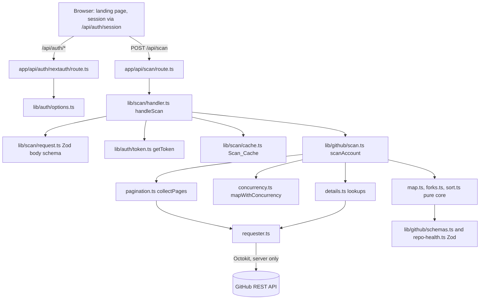
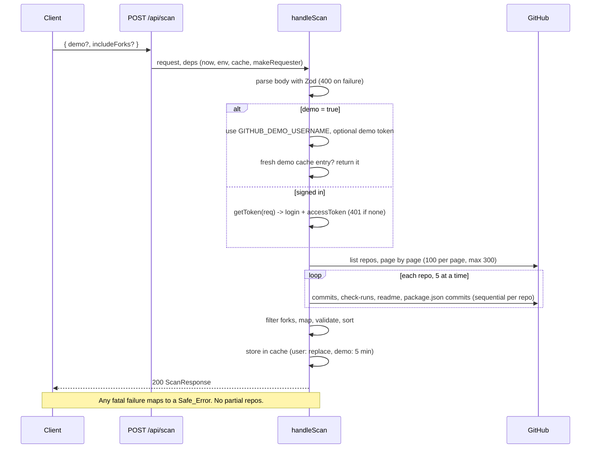

# Design Document

## Overview

This feature adds GitHub sign-in and repository ingestion. A server route, `POST /api/scan`, fetches a user's repositories (or the demo account's) from GitHub, validates every response with Zod, maps the data to `RepoHealth` objects, and returns them with a few counters. It collects facts only. Scoring, epitaphs, and AI are out of scope.

The design is split into a thin I/O shell and a pure core:

- **Shell:** Auth.js configuration, the two route handlers, an Octokit-backed requester, and an in-memory cache.
- **Core:** pure functions for validation, fork filtering, CI/dependency derivation, mapping, sorting, pagination, error classification, and cookie clearing. These carry the correctness properties.

### Resolved open questions

| Question | Decision | Rationale |
|---|---|---|
| Auth.js v4 or v5 | **Stay on `next-auth` 4.24.15** | v4.24.15 declares `next ^16` as a peer. Its route-handler code awaits `cookies()`, `headers()` and `context.params`, which matches the async APIs in the installed Next 16.4.6. It reads `AUTH_SECRET` as a fallback when `NEXTAUTH_SECRET` is unset (verified in `node_modules/next-auth/next/index.js`), so the steering env name works unchanged. v5 would rename env variables (`AUTH_GITHUB_ID`, `AUTH_GITHUB_SECRET`), change the session API, and add migration risk with no feature we need. |
| How to detect `outdatedDeps` | **Manifest staleness proxy, GitHub-only.** `outdatedDeps` is `true` when the latest commit touching root `package.json` is more than 365 days older than `now`, `false` when it is newer, and `null` when there is no root `package.json` or the lookup fails. | A true "newer version exists" check needs the npm registry (a second external service, per-dependency calls, no lockfile parsing for other ecosystems). That breaks the 5-in-flight budget and the unauthenticated demo limit of 60 requests per hour. The proxy costs one request per repository, is deterministic given `now`, and keeps `null` for "unknown" as the requirements define. The UI must label it honestly (for example "dependencies untouched for over a year"). A registry-based check can replace `deriveOutdatedDeps` later without changing the `RepoHealth` shape. |
| Env variable for the demo username | **`GITHUB_DEMO_USERNAME`** | Pairs with the existing `GITHUB_DEMO_TOKEN`. No default value: when unset or empty, demo mode is unavailable (requirement 9.3). The value is validated against GitHub's username pattern before use. |

### Research findings that shaped the design

- **Route Handlers** ([Next.js docs, `route.md` and `15-route-handlers.md`, installed copy](../../../node_modules/next/dist/docs/01-app/01-getting-started/15-route-handlers.md)): `route.ts` files export named HTTP method functions. `POST` handlers are never cached. `request.cookies` and `NextRequest` are available. `context.params` is a Promise.
- **Environment variables** (`environment-variables.md`): variables without `NEXT_PUBLIC_` stay on the server. `.env*` files load from the project root, not `src/`. All our secrets use plain names, so none can be inlined into the client bundle.
- **`cacheComponents: true`** is set in `next.config.ts`. Route Handlers that read the request are dynamic, and we do not use `use cache`. The Scan_Cache is a module-level `Map`, not a Next.js cache.
- **`proxy.ts`** replaces `middleware.ts` in Next 16. We do not need it. Authorization runs inside the route handler, as the Next authentication guide recommends over proxy-only checks.
- **`server-only` package** is not installed and is not mentioned in the installed docs. Instead of adding a dependency, client exclusion is enforced by (a) importing GitHub code only from route handlers and `src/lib`, never from files with `"use client"`, (b) an ESLint `no-restricted-imports` rule for `octokit` outside `src/lib/github/`, and (c) a post-build check that greps `.next/static` for `octokit` (requirement 5.1).
- **Octokit 5 (`octokit` package)** ships the retry and throttling plugins enabled by default and logs to `console`. Both must be disabled: retries and throttle waits would hide rate limits and could break the 10 second budget, and default logging may print request details. See "GitHub requester".
- **GitHub rate limits** ([GitHub REST docs](https://docs.github.com/en/rest/using-the-rest-api/best-practices-for-using-the-rest-api)): a primary or secondary limit returns 403 or 429, with `x-ratelimit-remaining: 0` and `x-ratelimit-reset`, or a `retry-after` header. A 403 without those signals is a permission problem. Classification follows this.
- **Auth.js v4 GitHub provider:** the default scope is `read:user user:email`, and the provider calls `/user/emails` when the profile has no email. We override the scope to `public_repo`. The extra call then fails harmlessly (its `res.ok` check skips the result), and we never read email.
- **Content was rephrased for compliance with licensing restrictions.**

## Architecture



### Request flow



### Module layout

Everything under `src/lib` is framework-free where possible and gets Vitest tests next to it (`*.test.ts`). Named exports only. Route files are the only default-export-free exceptions Next requires (`route.ts` uses named method exports).

```
src/
  app/
    api/auth/[...nextauth]/route.ts   # Auth.js handler, wrapped by config guard
    api/scan/route.ts                 # thin: builds deps, calls handleScan
  lib/
    env.ts                            # readAuthEnv, readDemoConfig (pure over an env record)
    auth/
      options.ts                      # authOptions (GitHub provider, callbacks)
      callbacks.ts                    # pure jwt/session callback logic
      token.ts                        # readUserToken(req): { login, accessToken } | null
      session-cookies.ts              # sessionCookieNames(cookieNames), clearSessionCookies
      error-messages.ts               # Auth.js error code -> landing Safe_Error
    github/
      repo-health.ts                  # RepoHealth schema and type
      schemas.ts                      # GitHub payload schemas (repo, commit, check-runs, readme)
      requester.ts                    # GitHubRequester type, createOctokitRequester
      errors.ts                       # classifyGitHubFailure, ScanFailure
      pagination.ts                   # parseHasNextPage, collectPages
      concurrency.ts                  # mapWithConcurrency
      details.ts                      # fetch lookups: commit, ci, readme, manifest
      derive.ts                       # deriveCiStatus, deriveOutdatedDeps
      forks.ts                        # filterForks
      validate-list.ts                # splitValidEntries
      sort.ts                         # compareCodePoint, sortByName
      map.ts                          # toRepoHealth
      scan.ts                         # scanAccount (orchestrator)
    scan/
      request.ts                      # ScanRequest schema
      response.ts                     # ScanResponse and SafeError schemas, error code table
      cache.ts                        # createScanCache(now)
      handler.ts                      # handleScan(deps, request)
  types/next-auth.d.ts                # augments Session and JWT
e2e/scan-demo.spec.ts
```

## Components and Interfaces

### Environment (`lib/env.ts`)

```ts
export type AuthEnv = { githubId: string; githubSecret: string; authSecret: string };
export function readAuthEnv(env: Record<string, string | undefined>): AuthEnv | null;
export type DemoConfig = { username: string; token: string | null };
export function readDemoConfig(env: Record<string, string | undefined>): DemoConfig | null;
```

- `readAuthEnv` returns `null` if any of `GITHUB_ID`, `GITHUB_SECRET`, `AUTH_SECRET` is missing or empty (after `trim`). Callers never put variable names in responses (requirement 1.8).
- `readDemoConfig` returns `null` when `GITHUB_DEMO_USERNAME` is missing, empty, or does not match `^[A-Za-z0-9](?:[A-Za-z0-9-]{0,38})$`. `token` is `null` when `GITHUB_DEMO_TOKEN` is missing or empty.
- Both take the env record as an argument, so tests do not touch `process.env`.

### Auth.js configuration (`lib/auth/*`)

```ts
export const authOptions: NextAuthOptions = {
  providers: [GithubProvider({
    clientId, clientSecret,
    authorization: { params: { scope: "public_repo" } },   // replaces the default scope
  })],
  session: { strategy: "jwt" },
  secret: authSecret,
  pages: { signIn: "/", error: "/" },                       // errors return to the landing page with ?error=<code>
  callbacks: { jwt, session },
};
```

Token handling (requirements 1.2, 1.3, 1.5):

- Auth.js v4 with the JWT strategy stores the session in an encrypted JWE cookie (`next-auth.session-token`, `__Secure-` prefix on HTTPS). The browser cannot read the contents. This satisfies "held only in the Auth.js session on the server" and the no-database rule.
- `jwt` callback: on first sign-in, copy `account.access_token` to `token.accessToken` and the raw profile's `login` to `token.login`, `avatar_url` to `token.avatarUrl`. On later calls, return the token unchanged.
- `session` callback: return `{ user: { login, image }, expires }` only. It never copies `accessToken`. This is what `GET /api/auth/session` returns.
- `getToken({ req, secret })` (from `next-auth/jwt`), used only inside the scan handler, reads `accessToken` and `login`. The `readUserToken(req)` wrapper validates the decoded value with Zod (`login` non-empty string, `accessToken` non-empty string) and returns `null` if invalid.
- `callbacks.ts` holds the callback bodies as pure functions so they can be property tested without Auth.js.

Sign-in disabled when unconfigured (requirement 1.8): `route.ts` for `/api/auth/[...nextauth]` checks `readAuthEnv(process.env)`. If `null`, it returns a Safe_Error `auth_not_configured` (HTTP 503) for every auth request instead of calling NextAuth. The `authOptions` factory is only built when configured.

Landing page errors (requirements 1.6, 1.7): `error-messages.ts` maps the `error` query value to a Safe_Error message. `AccessDenied` gives "Sign-in was cancelled." Every other value gives "Sign-in failed. You can try again." The landing page renders only these two fixed strings, never the raw query value.

Sign-out (requirement 1.9): the UI calls `signOut({ callbackUrl: "/" })`. Auth.js clears the cookie and redirects. The token is discarded because it only lived in that cookie.

Revoked token (requirement 7.2): with a stateless JWT the server cannot invalidate a session, so the scan response clears the session cookies itself. `session-cookies.ts`:

```ts
export function sessionCookieNames(requestCookieNames: string[]): string[];
// returns every name equal to, or equal to name + ".<digits>" (chunked cookies) of,
// "next-auth.session-token" or "__Secure-next-auth.session-token"
export function appendClearCookies(headers: Headers, names: string[]): void;
// adds Set-Cookie: <name>=; Max-Age=0; Path=/; HttpOnly; SameSite=Lax (+ Secure for __Secure- names)
```

The next request has no valid session cookie, so it returns 401.

### Scan request and response (`lib/scan/request.ts`, `response.ts`)

```ts
export const ScanRequestSchema = z.object({
  demo: z.boolean().optional(),
  includeForks: z.boolean().optional(),
});                                   // unknown keys (such as "username") are stripped
export type ScanRequest = { demo: boolean; includeForks: boolean };   // defaults false
export function parseScanRequest(raw: unknown): ScanRequest | null;
```

Body handling in the route: an empty body is treated as `{}`. Invalid JSON, a non-object, or a wrong-typed field returns HTTP 400 `validation_error` before any GitHub call. The response never echoes the input.

```ts
export const ScanSuccessSchema = z.object({
  mode: z.enum(["user", "demo"]),
  repos: z.array(RepoHealthSchema),
  skippedForks: z.number().int().nonnegative(),
  skippedInvalid: z.number().int().nonnegative(),
  truncated: z.boolean(),
  code: z.enum(["empty_account", "rate_limited"]).optional(),
  stale: z.boolean().optional(),
  cachedAt: z.iso.datetime().optional(),   // present when stale
  resetAt: z.iso.datetime().optional(),    // present when stale and GitHub gave a reset time
});
export const SafeErrorSchema = z.object({
  error: z.object({
    code: ErrorCodeSchema,
    message: z.string(),
    resetAt: z.iso.datetime().optional(),  // rate_limited only
  }),
});
```

Error code table (single source of truth for status and message):

| Code | HTTP | Message (fixed text) |
|---|---|---|
| `validation_error` | 400 | The request was not valid. |
| `unauthorized` | 401 | Sign in to scan your repositories. |
| `token_revoked` | 401 | Your GitHub session expired. Sign in again. |
| `forbidden` | 403 | GitHub refused this request. |
| `account_not_found` | 404 | That GitHub account was not found. |
| `rate_limited` | 429 | GitHub request limits were reached. Try again later. |
| `invalid_github_response` | 502 | The scan could not be completed. |
| `github_unavailable` | 502 | GitHub could not be reached. Try again later. |
| `auth_not_configured` | 503 | Sign-in is not available right now. |
| `demo_unavailable` | 503 | Demo mode is not available right now. |
| `internal_error` | 500 | Something went wrong. Try again. |

Messages are constants. No error message is ever built from upstream text, so nothing upstream can leak into a response (requirements 5.2 to 5.5).

Scan failures that are not empty-account (requirement 8.4) always use one of the codes above, never `empty_account`. `empty_account` exists only in `ScanSuccess.code`.

The mode is `demo` for every demo response, cached or fresh, and `user` otherwise (requirements 9.11, 9.12).

### GitHub requester (`lib/github/requester.ts`)

Ingestion depends on a minimal function type, not on Octokit directly (requirement 11.4):

```ts
export type GitHubResponse = { status: number; headers: Record<string, string | undefined>; data: unknown };
export type GitHubRequester = (route: string, params: Record<string, unknown>) => Promise<GitHubResponse>;
export function createOctokitRequester(token: string | null): GitHubRequester;
```

`createOctokitRequester` is the only place that imports `octokit`:

```ts
const octokit = new Octokit({
  auth: token ?? undefined,
  throttle: { enabled: false },
  retry: { enabled: false },
  log: { debug() {}, info() {}, warn() {}, error() {} },   // nothing is logged by the client
});
octokit.hook.wrap("request", (request, options) =>
  request({ ...options, request: { ...options.request, signal: AbortSignal.timeout(10_000) } }));
```

Each call gets its own 10 second abort signal (requirements 2.13, 7.4). The returned `data` is `unknown` on purpose, so callers must validate before use. Read-only is enforced by construction: the requester is only ever called with `GET` routes defined as constants in `details.ts` and `scan.ts` (requirement 9.4). A unit test asserts every route string starts with `GET `.

Octokit throws `RequestError` for non-2xx responses. `classifyGitHubFailure` accepts `unknown` and extracts `status`, `response.headers`, and a message through a Zod schema, so no type assertions are used.

### Failure classification (`lib/github/errors.ts`)

```ts
export type ScanFailure =
  | { kind: "rate_limited"; resetAt?: string }
  | { kind: "token_revoked" }
  | { kind: "forbidden" }
  | { kind: "not_found" }
  | { kind: "unavailable" }                // 5xx, network error, timeout
  | { kind: "invalid_response" };          // Zod failure
export class ScanFailureError extends Error { constructor(readonly failure: ScanFailure) }
export function classifyGitHubFailure(error: unknown, now: Date): ScanFailure;
```

Rules (requirements 6.1 to 6.3, 7.1, 7.3, 7.4, 8.3):

1. `status === 429` is `rate_limited`.
2. `status === 403` is `rate_limited` when `x-ratelimit-remaining` is `"0"`, or a `retry-after` header is present, or the message matches `/rate limit/i`. Otherwise `forbidden`.
3. `status === 401` is `token_revoked`.
4. `status === 404` is `not_found`.
5. `status >= 500`, an abort or timeout, or any error without a status is `unavailable`.
6. `resetAt` comes from `x-ratelimit-reset` (epoch seconds) converted to ISO 8601 UTC. If absent, from `retry-after` (seconds) added to `now`. If neither is a finite non-negative number, `resetAt` is omitted.

`now` is an argument, so the function stays pure.

### Pagination (`lib/github/pagination.ts`)

```ts
export const PAGE_SIZE = 100;
export const REPO_LIMIT = 300;
export type RepoPage = { items: unknown[]; hasNext: boolean };
export function parseHasNextPage(linkHeader: string | undefined): boolean;   // looks for rel="next"
export async function collectPages(
  fetchPage: (page: number) => Promise<RepoPage>,
  limit?: number,
): Promise<{ items: unknown[]; truncated: boolean }>;
```

`collectPages` requests pages 1, 2, ... until `hasNext` is false or at least `limit` items are collected. It slices to the first `limit` items. `truncated` is `true` when the collected total exceeds `limit`, or when `limit` is reached and `hasNext` is still true. Exactly 300 items with no further page gives `truncated: false`. Any rejection from `fetchPage` rejects the whole call, so no partial list is returned (requirement 4.6). Known edge: if GitHub's Link header says there is a next page but it is empty, `truncated` can be a false positive. This is acceptable.

The list endpoint is `GET /user/repos` with `affiliation: "owner"`, `sort: "full_name"`, `direction: "asc"` for signed-in mode, and `GET /users/{username}/repos` with `type: "owner"` and the same sort for demo mode. A stable server-side order makes "first 300 in GitHub's returned order" deterministic.

### Entry validation (`lib/github/validate-list.ts`)

```ts
export function splitValidEntries(items: unknown):
  | { ok: true; repos: GitHubRepo[]; skippedInvalid: number }
  | { ok: false };
```

Returns `ok: false` when `items` is not an array, or when it is non-empty and every entry is invalid (requirements 10.3, 10.5). Otherwise each entry is parsed with `GitHubRepoSchema.safeParse`. Invalid ones are counted and dropped (requirement 10.4). An empty array is valid and gives zero repos.

### Fork filter (`lib/github/forks.ts`)

```ts
export function filterForks<T extends { fork: boolean }>(repos: T[], includeForks: boolean):
  { kept: T[]; skippedForks: number };
```

When `includeForks` is false, forks are removed and counted once each, whether or not archived. Archived non-forks always stay. When true, nothing is removed and `skippedForks` is 0.

### Concurrency (`lib/github/concurrency.ts`)

```ts
export const DETAIL_CONCURRENCY = 5;
export async function mapWithConcurrency<T, R>(items: T[], limit: number, fn: (item: T, index: number) => Promise<R>): Promise<R[]>;
```

A worker-pool implementation. At most `limit` calls to `fn` are in flight. The result array keeps input order. On the first rejection it stops starting new work and rejects with that error (fatal failures abort the scan). Within one repository, lookups run one after another, so one repository uses at most one in-flight request (requirement 4.5).

### Detail lookups (`lib/github/details.ts`)

Four lookups per repository, run in sequence, each with a Zod-validated response:

| Lookup | Route | Result |
|---|---|---|
| Latest commit | `GET /repos/{owner}/{repo}/commits` with `per_page: 1` | `lastCommitAt` from `commit.committer.date`. HTTP 409 (empty repository) or an empty array gives `null`. |
| CI | `GET /repos/{owner}/{repo}/commits/{default_branch}/check-runs` with `per_page: 100` | list of `conclusion` values, then `deriveCiStatus`. HTTP 404 gives `none`. |
| README | `GET /repos/{owner}/{repo}/readme` | 200 gives `true`, 404 gives `false`. |
| Manifest | `GET /repos/{owner}/{repo}/commits` with `path: "package.json"`, `per_page: 1` | committer date of the latest commit touching it, or `null` if the list is empty. |

If the latest-commit lookup returns "empty repository", the other three are skipped and defaults are used (`ciStatus: none`, `hasReadme: false`, `outdatedDeps: null`).

Error handling per lookup (requirements 7.5, 7.6, 10.3):

- 401 or rate limit: rethrown as `ScanFailureError`. The scan stops and partial results are discarded.
- Any other HTTP or network failure: the lookup falls back to a default and the repository stays in the result. Defaults: `lastCommitAt` falls back to the repository's `pushed_at` from the list payload, `ciStatus` is `none`, `hasReadme` is `false`, `outdatedDeps` is `null`. Other repositories are unaffected.
- A response that fails Zod validation: rethrown as `invalid_response`. The whole scan fails with `invalid_github_response` (requirements 2.13, 11.9). A malformed payload is a contract problem, not a transient one, and silently defaulting would hide it.

Request cost per repository is at most 4. A 300-repository scan is at most 1200 detail requests plus 3 list requests. An authenticated token (5000 per hour) handles this. Unauthenticated demo mode (60 per hour) cannot, so `GITHUB_DEMO_TOKEN` is strongly recommended and the 5 minute demo cache absorbs repeat visits. When the demo account is rate limited, the response is `rate_limited` as specified.

### Derivations (`lib/github/derive.ts`)

```ts
export type CiStatus = "passing" | "failing" | "none";
export function deriveCiStatus(conclusions: ReadonlyArray<string | null>): CiStatus;
export const OUTDATED_MANIFEST_DAYS = 365;
export function deriveOutdatedDeps(manifestCommittedAt: string | null, now: Date): boolean | null;
```

- `deriveCiStatus`: empty list is `none`. Any conclusion in `failure`, `timed_out`, `startup_failure` is `failing`. Otherwise `passing` (requirements 2.4 to 2.6). `null` conclusions (still running) are not failures.
- `deriveOutdatedDeps`: `null` input gives `null`. An unparseable date gives `null`. Otherwise `true` when `now - date > 365 days`, else `false`. A manifest date in the future gives `false`.

### Mapping and sorting (`lib/github/map.ts`, `sort.ts`)

```ts
export type RepoDetails = { lastCommitAt: string | null; ciStatus: CiStatus; hasReadme: boolean; outdatedDeps: boolean | null };
export function toRepoHealth(repo: GitHubRepo, details: RepoDetails): RepoHealth;
export function compareCodePoint(a: string, b: string): number;
export function sortByName<T extends { name: string }>(items: readonly T[]): T[];
```

`toRepoHealth` is a pure field mapping: `name`, `html_url` to `url`, `description`, `archived`, `stargazers_count` to `stars`, `open_issues_count` to `openIssues`, `language`, plus the detail fields. Time-dependent work (`deriveOutdatedDeps`) happens before mapping with `now` passed in (requirement 11.2). Note that GitHub's `open_issues_count` includes pull requests. This is documented and accepted for v1.

`compareCodePoint` compares by Unicode code point, not UTF-16 code unit, so astral characters sort correctly. `sortByName` returns a new array.

### Orchestrator (`lib/github/scan.ts`)

```ts
export type ScanAccount = { kind: "user" } | { kind: "demo"; username: string };
export type ScanData = { repos: RepoHealth[]; skippedForks: number; skippedInvalid: number; truncated: boolean };
export async function scanAccount(deps: { request: GitHubRequester; now: Date }, account: ScanAccount, includeForks: boolean): Promise<ScanData>;
```

Steps: `collectPages` over the list route, `splitValidEntries`, `filterForks`, `mapWithConcurrency` over repos calling the lookups, `toRepoHealth`, `RepoHealthSchema.parse` check on each output (requirement 10.6), `sortByName`. Any `ScanFailureError` propagates. `not_found` on the first list page becomes `account_not_found` in the handler.

### Scan cache (`lib/scan/cache.ts`)

```ts
export type CacheEntry = { data: ScanData; includeForks: boolean; storedAt: number };
export function createScanCache(): {
  get(key: string, nowMs: number, ttlMs: number, includeForks: boolean): CacheEntry | null;
  set(key: string, data: ScanData, includeForks: boolean, nowMs: number): void;
};
export const USER_CACHE_TTL_MS = 3_600_000;
export const DEMO_CACHE_TTL_MS = 300_000;
```

- A module-level singleton (kept on `globalThis` so dev hot reload keeps it) with keys `user:<lowercased login>` and `demo`.
- `get` returns the entry only when `nowMs - storedAt < ttlMs` and `includeForks` matches. It deletes expired entries it finds.
- One entry per key, replaced on every success (requirement 6.6). Because forks change the result, an entry made with a different `includeForks` is treated as a miss rather than returning the wrong list. This is the one place the design is stricter than "keyed by login" in the requirements.
- Entries hold `ScanData` only, which has no token field (requirement 6.8). The cache lives in server memory and is lost on restart. In a multi-instance deployment each instance has its own copy; v1 accepts that (no database rule).
- `now` is an argument, so tests control time.

### Handler (`lib/scan/handler.ts`)

```ts
export type ScanDeps = {
  now: () => Date;
  env: Record<string, string | undefined>;
  cache: ScanCache;
  makeRequester: (token: string | null) => GitHubRequester;
  readUserToken: (req: Request) => Promise<{ login: string; accessToken: string } | null>;
  log: (entry: { code: string; requestId: string }) => void;
};
export async function handleScan(deps: ScanDeps, req: NextRequest): Promise<Response>;
```

Order of work:

1. Create a `requestId` (`crypto.randomUUID()`). Parse and validate the body. Failure gives 400.
2. **Demo** (`demo: true`, regardless of session; requirement 9.13): read `readDemoConfig`. If `null`, return `demo_unavailable` without calling GitHub or touching the cache. If a fresh demo cache entry exists, return it with `mode: "demo"`. Otherwise scan with `makeRequester(demoToken)`. On success, store under key `demo`. On failure, return the mapped error and leave the cache unchanged. The session and user token are never read.
3. **Signed in**: if `readAuthEnv` is `null`, return `auth_not_configured`. Read the user token. `null` gives `unauthorized`. Scan with `makeRequester(accessToken)`. Success: store under `user:<login>`, return `mode: "user"`.
4. Result shaping: an empty `repos` with no invalid entries gives `code: "empty_account"` (requirements 8.1, 8.2). Zero repos because every entry was invalid is already a 502 in `splitValidEntries`.
5. Failure mapping from `ScanFailure` to code table:
   - `rate_limited`: if a user-mode cache entry exists for the same login and fork setting (not expired), return 200 with the cached data, `stale: true`, `cachedAt`, `code: "rate_limited"`, and `resetAt` when known (requirement 6.4). Otherwise 429 with `resetAt` when known. The demo cache has a 5 minute TTL and is not used as a stale fallback.
   - `token_revoked`: 401, plus clear session cookies on the response (requirement 7.2). User mode only.
   - `forbidden`: 403, session kept.
   - `not_found`: `account_not_found` 404 (only when raised by the list request).
   - `unavailable` and non-fatal list failures: `github_unavailable` 502. An error on a later list page after earlier pages also ends here or as the underlying classification, with no partial list (requirement 4.6).
   - `invalid_response`: `invalid_github_response` 502.
   - anything else: `internal_error` 500.
6. Logging: the only log call is `log({ code, requestId })`, with the error code only. No messages, stacks, headers, or tokens (requirements 5.3 to 5.5). The handler never calls `console.log` with error objects.
7. Before returning success, the full body is parsed with `ScanSuccessSchema`. A failure there is `internal_error`.

`app/api/scan/route.ts` is a few lines: it builds `ScanDeps` from `process.env`, `createOctokitRequester`, `readUserToken` (using `getToken`), the singleton cache, and calls `handleScan`.

### Session typing (`src/types/next-auth.d.ts`)

Module augmentation adds `user.login` to `Session` and `accessToken`, `login`, `avatarUrl` to `JWT`, so no type assertions are needed in callbacks.

## Data Models

### RepoHealth (`lib/github/repo-health.ts`)

```ts
export const RepoHealthSchema = z.strictObject({
  name: z.string().min(1),
  url: z.url(),
  description: z.string().nullable(),
  lastCommitAt: z.iso.datetime({ offset: true }).nullable(),
  openIssues: z.number().int().nonnegative(),
  archived: z.boolean(),
  ciStatus: z.enum(["passing", "failing", "none"]),
  hasReadme: z.boolean(),
  outdatedDeps: z.boolean().nullable(),
  stars: z.number().int().nonnegative(),
  language: z.string().nullable(),
});
export type RepoHealth = z.infer<typeof RepoHealthSchema>;
```

`z.number().int()` rejects `NaN` and infinities in Zod 4. `strictObject` makes a missing or extra field a validation failure. Every field is always present (nullable, not optional), so JSON round trips are exact.

### GitHub payload schemas (`lib/github/schemas.ts`)

Only the fields we read, nothing is trusted beyond the schema. Unknown keys are stripped.

```ts
export const GitHubRepoSchema = z.object({
  name: z.string().min(1),
  html_url: z.url(),
  description: z.string().nullable(),
  fork: z.boolean(),
  archived: z.boolean(),
  stargazers_count: z.number().int().nonnegative(),
  open_issues_count: z.number().int().nonnegative(),
  language: z.string().nullable(),
  pushed_at: z.iso.datetime({ offset: true }).nullable(),
  default_branch: z.string().min(1),
  owner: z.object({ login: z.string().min(1) }),
});
export const CommitListSchema = z.array(z.object({
  commit: z.object({ committer: z.object({ date: z.iso.datetime({ offset: true }) }).nullable() }),
}));
export const CheckRunsSchema = z.object({
  total_count: z.number().int().nonnegative(),
  check_runs: z.array(z.object({ conclusion: z.string().nullable() })),
});
```

The README lookup validates only that a 200 response is an object with a `name` string. The `RequestError` shape (status, response headers, message) has its own schema in `errors.ts`.

### Session and JWT

| Where | Fields | Visible to client |
|---|---|---|
| JWT (encrypted cookie) | `accessToken`, `login`, `avatarUrl`, standard claims | No (encrypted, `HttpOnly`) |
| `Session` (from `/api/auth/session`) | `user.login`, `user.image`, `expires` | Yes |

### Environment variables

`.env.example` gains these names only (no values):

```
GITHUB_ID=
GITHUB_SECRET=
AUTH_SECRET=
LLM_API_KEY=
GITHUB_DEMO_TOKEN=
# Public GitHub username scanned in demo mode (no default; demo is disabled when empty)
GITHUB_DEMO_USERNAME=
# Auth.js v4 base URL. Required in production outside Vercel.
NEXTAUTH_URL=
```

`NEXTAUTH_URL` is not a secret. It is needed by Auth.js v4 for OAuth callback URLs in production.

## Correctness Properties

Each item below is a formal statement about what the system must do for all valid inputs. Each one maps to a single automated test.

Reflection on overlap: the fork-count rule (3.4, 3.6) merges into the fork filter property. Request validation (2.10, 2.11, 3.5) and the ignored username (2.14) merge into one request-schema property. The cache replace rule (6.6) and TTL rule (6.7, 9.10) merge. The rate-limit and forbidden classifications (6.1 to 6.3, 7.3) merge. The mapping output validity (2.1, 2.2, 10.6) and determinism (11.3) stay separate, since one is about schema conformance and the other about repeatability. Invalid-entry splitting (10.4, 10.5) and RepoHealth rejection (10.7, 10.8, 10.10) stay separate because they test different functions.

### Property 1: Pagination invariant

*For any* list of repositories and *any* partition of it into consecutive non-empty pages, `collectPages` over those pages returns exactly the first 300 items of the list in the same order, the result does not depend on how the list was split, and `truncated` is true if and only if the list has more than 300 items. If any page request rejects, `collectPages` rejects and returns no items.

**Validates: Requirements 4.1, 4.3, 4.4, 4.6, 4.7**

### Property 2: Fork filter and skipped count

*For any* list of repositories (each with arbitrary `fork` and `archived` flags) and *any* `includeForks` value, `filterForks` returns `kept` equal to all repositories when `includeForks` is true, or all non-forks in original order when false. `skippedForks` equals the number of removed forks (0 when `includeForks` is true), is between 0 and the list length, and `kept.length + skippedForks` equals the list length. Archived non-forks are always kept, and an archived fork is counted exactly once when excluded.

**Validates: Requirements 3.1, 3.2, 3.3, 3.4, 3.6**

### Property 3: RepoHealth JSON round trip

*For any* valid `RepoHealth` object, parsing `JSON.stringify(object)` with `RepoHealthSchema` succeeds and yields an object deeply equal to the original.

**Validates: Requirements 10.9**

### Property 4: RepoHealth schema rejects invalid values

*For any* otherwise valid `RepoHealth` object with one field replaced by an invalid value (a `ciStatus` outside `passing`, `failing`, `none`; a negative, fractional, `NaN`, or infinite `openIssues` or `stars`; a missing required field; a wrong type; or `null` in place of the whole object), `RepoHealthSchema.safeParse` returns a failure result and does not throw.

**Validates: Requirements 10.7, 10.8, 10.10**

### Property 5: Mapping is schema-valid and deterministic

*For any* valid `GitHubRepo` and *any* `RepoDetails`, `toRepoHealth` returns an object that passes `RepoHealthSchema` and carries the repository's name, URL, description, archived flag, stars, open issue count and language unchanged. Calling it repeatedly with the same inputs returns deeply equal results.

**Validates: Requirements 2.1, 2.2, 2.3, 11.1, 11.3**

### Property 6: CI status derivation

*For any* list of check-run conclusions, `deriveCiStatus` returns `none` when the list is empty, `failing` when the list contains at least one of `failure`, `timed_out` or `startup_failure`, and `passing` otherwise.

**Validates: Requirements 2.4, 2.5, 2.6**

### Property 7: Outdated dependency derivation

*For any* `now` and *any* manifest commit date, `deriveOutdatedDeps` returns `null` when the date is `null`. Otherwise it returns a boolean that is `true` if and only if `now` is more than 365 days after the date. For a fixed date, the result is monotonic in `now`: once `true`, it stays `true` for later times.

**Validates: Requirements 2.7, 11.2**

### Property 8: Output ordering

*For any* list of repositories with distinct names, in *any* input order, `sortByName` returns a permutation of the input that is ordered by Unicode code point, and the result is identical for every shuffle of the input. `compareCodePoint` is consistent with comparing the `Array.from` code point sequences, including for astral characters.

**Validates: Requirements 2.15**

### Property 9: Concurrency limit and order

*For any* list of items and *any* async task durations, `mapWithConcurrency` with limit 5 never has more than 5 tasks in flight at once, calls the task function exactly once per item, and returns results in input order.

**Validates: Requirements 4.5**

### Property 10: Valid and invalid entry split

*For any* list that mixes valid GitHub repository payloads with invalid entries (wrong types, missing fields, `null`), `splitValidEntries` returns `ok: true` with `repos.length + skippedInvalid` equal to the list length and `repos` equal to the valid entries in order, unless every entry is invalid or the input is not an array, in which case it returns `ok: false`.

**Validates: Requirements 10.3, 10.4, 10.5**

### Property 11: GitHub failure classification

*For any* HTTP status, header set and message, `classifyGitHubFailure` returns `rate_limited` when the status is 429, or when the status is 403 and `x-ratelimit-remaining` is `"0"` or `retry-after` is present or the message mentions a rate limit. It returns `forbidden` for every other 403, `token_revoked` for 401, `unavailable` for 5xx or errors with no status, and never returns a rate-limit result for a 401. When `rate_limited` carries `resetAt`, it is a valid ISO 8601 UTC string derived from `x-ratelimit-reset` or from `now` plus `retry-after`, and it is omitted when neither header is a valid number.

**Validates: Requirements 6.1, 6.2, 6.3, 7.1, 7.3, 7.4**

### Property 12: Cache time-to-live and replacement

*For any* cache key, stored result, store time, query time and TTL, `get` returns the entry if and only if the query time is less than `TTL` after the store time and the `includeForks` value matches. After two `set` calls to the same key, `get` returns only the later entry.

**Validates: Requirements 6.6, 6.7, 9.8, 9.10**

### Property 13: Request body validation

*For any* JSON value, `parseScanRequest` returns a value only when the input is an object whose `demo` and `includeForks` fields, if present, are booleans. A non-boolean `includeForks` or `demo` always yields `null`. For any accepted body that also carries extra keys such as `username`, the parsed result contains no such key.

**Validates: Requirements 2.10, 2.11, 2.14, 3.5**

### Property 14: Safe errors never leak secrets

*For any* secret-like string (token, API key, client secret) embedded in the message, headers, stack or body of an upstream error value, the Safe_Error produced by the handler's error mapping, its JSON serialization, and the log record contain neither the secret nor any text from the upstream error. The body's `code` is one of the fixed error codes and `message` is the fixed text for that code.

**Validates: Requirements 5.2, 5.3, 5.4, 5.5, 7.1, 11.9**

### Property 15: Session callbacks never expose the access token

*For any* access token string, login and avatar URL, the object returned by the `session` callback contains the login and avatar URL and its JSON serialization does not contain the access token. The `jwt` callback keeps the token in the JWT.

**Validates: Requirements 1.2, 1.3, 1.5**

### Property 16: Session cookie clearing

*For any* set of request cookie names, `sessionCookieNames` returns exactly those names that equal `next-auth.session-token` or `__Secure-next-auth.session-token`, or equal one of them followed by `.` and digits (chunked cookies). It returns no other name, and every returned name appears in the generated `Set-Cookie` clearing headers with `Max-Age=0`.

**Validates: Requirements 7.2, 1.9**

## Error Handling

- **Typed failures:** I/O code throws `ScanFailureError` carrying a `ScanFailure`. The handler is the only place that turns failures into HTTP responses, using the fixed table in "Scan request and response".
- **No partial results:** list failures, later-page failures, 401 or rate limit on any detail request, and Zod failures on any list or detail payload reject the whole scan. Only non-fatal HTTP failures on a single detail lookup are absorbed, using the defaults listed in "Detail lookups".
- **Untrusted values:** upstream error objects are read through a Zod schema into `status`, rate-limit headers and a message used only for classification. The message is never copied to any output.
- **Validation failures:** requests return `validation_error`; GitHub payload failures return `invalid_github_response` with no issue details.
- **Missing config:** unconfigured auth gives `auth_not_configured`, and unset `GITHUB_DEMO_USERNAME` gives `demo_unavailable`. Neither response names an environment variable.
- **Unexpected errors:** caught at the top of `handleScan`, logged as `{ code: "internal_error", requestId }` only, and returned as `internal_error` 500.
- **Rate limits:** user mode falls back to a cached result when one is unexpired (`stale: true`). Otherwise a 429 with an optional `resetAt`.
- **Revoked token:** 401 `token_revoked` and Set-Cookie headers that clear the session cookies.
- **Empty account:** HTTP 200 with `code: "empty_account"`. An upstream failure is never reported as empty because failures never reach the success path.
- **Auth.js errors:** the landing page shows one of two fixed messages chosen from the `error` query value, and never prints the raw value.

## Testing Strategy

### Why property-based testing applies

The core of this feature is pure logic over structured data: validation, filtering, pagination, derivation, mapping, sorting, classification, and TTL rules. These have clear universal statements, large input spaces, and are cheap to run. The I/O layer (Octokit, Auth.js, Next route wiring) is not property tested. It gets example-based tests with mocks and one end-to-end test.

### Property-based tests (fast-check, Vitest)

- Library: `fast-check` (already installed). No custom property framework.
- Each of Properties 1 to 16 is implemented by a **single** property test, run with at least 100 cases (`{ numRuns: 100 }` or higher).
- Each test carries a comment tag in the form `Feature: auth-ingestion, Property N: <property title>`.
- Shared arbitraries live in `src/lib/github/test-utils/arbitraries.ts` (valid `RepoHealth`, valid and invalid GitHub repo payloads, page partitions, header sets, cookie names). Use `fc.nat()` for counts, which avoids `-0` and keeps Property 3's deep equality exact.
- Time-dependent properties pass `now` as an argument. No test reads the system clock.

### Unit tests (Vitest, next to the code)

Every new function in `src/lib` gets at least one success and one failure or boundary example. Examples that matter beyond the properties:

- `readAuthEnv`, `readDemoConfig`: missing, empty, and whitespace values; invalid usernames; responses never name a variable.
- `authOptions`: scope is exactly `public_repo`; `pages.error` is `/`.
- `error-messages`: `AccessDenied` gives the cancelled message; other codes give the failed message.
- `parseHasNextPage`: real `Link` headers with and without `rel="next"`, malformed header.
- `details`: 409 on commits (empty repository) gives `lastCommitAt: null` and defaults; 404 readme gives `false`; non-fatal 500 on one lookup falls back to defaults and leaves others unchanged; 401 aborts; Zod failure raises `invalid_response`; every route string starts with `GET `.
- `handleScan` (with injected deps and a mocked requester): 400, 401, 403, 404, 429 (with and without cache, with and without reset time), 502, 500; demo with a session does not call `readUserToken` and does not touch the user cache; demo with unset username does not call GitHub; failed demo scan leaves the existing demo cache entry; `empty_account` for zero repos and for all-fork accounts; upstream failure never yields `empty_account`; the cache entry JSON does not contain the user token.
- A test setup file for Vitest replaces `fetch` and Node's HTTP agents so any real network request throws an error that names the blocked URL (requirement 11.8). Tests inject mocked requesters and never construct a real Octokit.

### Static and build checks

- ESLint: `no-restricted-imports` for `octokit` outside `src/lib/github/`, and a ban on `as` assertions and non-null assertions under `src/lib/github/` (requirement 10.2).
- `npm run typecheck` and `npm run lint` must pass.
- Post-build smoke script (run after `npm run build`) greps `.next/static` for `octokit`, expecting zero hits (requirement 5.1).

### End-to-end (Playwright, `e2e/`)

- `scan-demo.spec.ts`: `POST /api/scan` with `{ "demo": true }` while GitHub is mocked at the network layer. The test starts the app with `GITHUB_DEMO_USERNAME` set to a fixture name. It asserts the response parses with `ScanSuccessSchema`, `mode` is `demo`, and zero requests reached the real GitHub API (requirement 11.7).
- A second case posts `{ "includeForks": "yes" }` and expects 400.
- Sign-out timing (requirement 1.9) and the OAuth redirect (requirement 1.1) are checked at the integration level only: the sign-in link targets GitHub's authorize URL with `scope=public_repo`, using a mocked provider.

### Requirements that are not property tested

Requirements 1.1, 1.9, 5.1, 5.6, 10.1, 10.2 and 11.4 to 11.8 are smoke, static, or integration checks, listed above. Requirements 2.12, 2.13, 4.2, 6.4, 6.5, 7.4 to 7.6, 8.x and 9.x are handler branches that need only a few examples, since their behavior does not vary with input beyond what Properties 1, 2, 11 and 12 already cover.
