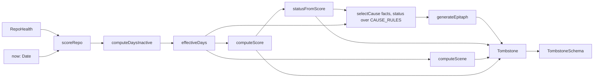
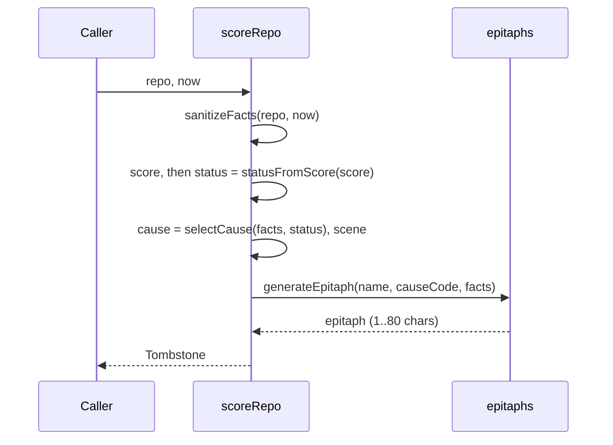

# Design Document

## Overview

This feature adds the deterministic scoring core of Repo Graveyard. One pure function, `scoreRepo(repo, now)`, turns a `RepoHealth` object and a `Date` into a `Tombstone`: a death score, a status, a cause of death, an epitaph, the whole days of inactivity, and the scene values (fog, candle, cracks, vines) that drive the tombstone visuals.

Two modules hold the code:

- `src/lib/scoring.ts`: constants, day math, score, status bands, cause rules, scene values, `scoreRepo`, `TombstoneSchema`.
- `src/lib/epitaphs.ts`: the template table, the FNV-1a hash, template selection and filling, name truncation.

Nothing here does I/O. There is no network, filesystem, clock read, randomness or AI. `now` is an argument. Every function is a small, single-purpose, named export, and each gets unit tests next to it.

`RepoHealth` is not redefined. It is imported as a type from `src/lib/github/repo-health.ts`, which the auth-ingestion design defines (`RepoHealthSchema`, `RepoHealth`). The import is `import type`, so scoring has no runtime dependency on the ingestion code, and the scoring tests build `RepoHealth` values by hand or with arbitraries.

### Design decisions

| Decision | Choice | Rationale |
|---|---|---|
| Rounding of inactivity points | Integer arithmetic: `floor((2 * MAX * d + FLAT) / (2 * FLAT))` with `d = min(effectiveDays, 365)` | Round-half-up without floating-point drift. For integer `d`, `70*d/365` never lands on exactly .5 (it would need `28d = 73(2k+1)`, which has no integer solution), so a floating-point `Math.round` reference in tests gives the same result. |
| Archived handling | Score is `max(computed, 90)`. Status is then `ancient` through the normal band function | One code path for status, so the status always matches the score band (assumption 1 in requirements). |
| Stale issues | Open issues count only when effective days is at least 90 | `RepoHealth` has no issue age (assumption 2). |
| Vines and cracks | Booleans | `RepoHealth` has no dependency or failing-check counts (assumptions 3 and 4). |
| Fog | Derived from effective days only, in 4 steps | Archived but recently active repos are not wrapped in fog that misstates inactivity (assumption 5). |
| Cause rules | An exported ordered array of 7 `{ code, label, kind, matches }` entries: six death rules in priority order, then the living rule. `selectCause(facts, status)` filters by `kind` from the status | Status is computed first, so status and cause cannot contradict. Order is visible in one place and testable (requirement 6.5). |
| Epitaph selection | FNV-1a of the repo name, modulo the number of eligible templates | Deterministic, no randomness, stable across runs. |
| `{days}` placeholder | Renders a duration phrase: `"412 days"`, `"1 day"` or `"a long time"` | Keeps sentences grammatical when days is null. The number inside the phrase is a base-10 integer. |
| Epitaph facts clamp | Counts are clamped to 999,999,999 before rendering | Keeps the worst-case text width known, so truncating only the name always fits in 80 characters. |
| Module dependency direction | `scoring.ts` imports from `epitaphs.ts`. `epitaphs.ts` exports `CAUSE_CODES` and `CauseCode` and imports nothing from scoring | Avoids a circular import. |
| Error strategy | No `try/catch`. Every step is total over its inputs | A catch would hide bugs. The no-throw property test checks totality. |

### Research findings

- **Zod 4** (already used by auth-ingestion): `z.number().int()` rejects `NaN` and infinities, `z.strictObject` rejects extra keys, and `.refine` issues carry a `path`. These cover requirements 11.3 to 11.7 and the "no `stars` in scene" rule (7.12).
- **FNV-1a, 32-bit** ([IETF draft description](https://datatracker.ietf.org/doc/html/draft-eastlake-fnv-17)): offset basis `0x811c9dc5`, prime `0x01000193`, XOR the byte then multiply. In JavaScript, use `Math.imul` and `>>> 0` to stay within 32 bits. Known vectors (empty string gives `0x811c9dc5`, `"a"` gives `0xe40c292c`) are used in unit tests. Content was rephrased for compliance with licensing restrictions.
- **fast-check** (`fc.date`, `fc.string`, `fc.record`, `fc.oneof`) supports invalid dates through `noInvalidDate: false`. The generators in this design rely on that.
- **Steering rules applied:** scoring is pure and AI is never used (tech.md); epitaphs joke about the repo, never the person, and say paused, not failed (product.md and design-system.md); fog, candle, cracks and vines map one-to-one to data (design-system.md); the UI shows text equivalents, so `daysInactive` is returned instead of being recomputed in the UI.

## Architecture



`scoreRepo` is a pipeline of pure functions. It sanitizes inputs once at the top, computes days, then derives every output from the same sanitized facts, so the pieces cannot disagree.



Layering follows the steering rules. UI components never compute scores. The UI receives `Tombstone` values from a server route or server component and only renders them.

## Components and Interfaces

### Constants (`scoring.ts`)

```ts
export const SCORING_CONSTANTS = {
  INACTIVITY_MAX_POINTS: 70,
  INACTIVITY_FLAT_DAYS: 365,
  FAILING_CI_POINTS: 12,
  ISSUE_POINTS_EACH: 2,
  ISSUE_POINTS_CAP: 8,
  OUTDATED_DEPS_POINTS: 6,
  NO_README_POINTS: 4,
  STALE_AFTER_DAYS: 90,
  ARCHIVED_MIN_SCORE: 90,
  CANDLE_WINDOW_DAYS: 30,
  DYING_CAUSE_ISSUES_MIN: 3,
  MAX_DAYS_INACTIVE: 36_500,
  UNKNOWN_DAYS: 365,
  MS_PER_DAY: 86_400_000,
} as const;

export const FOG_STEPS = [
  { minDays: 300, fog: 1 },
  { minDays: 120, fog: 0.66 },
  { minDays: 30, fog: 0.33 },
  { minDays: 0, fog: 0 },
] as const;                                  // checked top to bottom

export const STATUS_BANDS = [
  { min: 90, status: "ancient" },
  { min: 60, status: "dead" },
  { min: 25, status: "dying" },
  { min: 0, status: "alive" },
] as const;
```

`MAX_DAYS_INACTIVE`, `UNKNOWN_DAYS` and `MS_PER_DAY` are named so no magic numbers appear in code. The maximum total of the point sources is 70 + 12 + 8 + 6 + 4 = 100.

### Types

```ts
import type { RepoHealth } from "@/lib/github/repo-health";   // defined by auth-ingestion, not redefined
import { CAUSE_CODES, generateEpitaph, type CauseCode } from "@/lib/epitaphs";

export type Status = "alive" | "dying" | "dead" | "ancient";
export type Cause = { code: CauseCode; label: string };
export type Scene = { fog: 0 | 0.33 | 0.66 | 1; candle: boolean; cracks: boolean; vines: boolean };
export type Tombstone = {
  score: number; status: Status; cause: Cause; epitaph: string;
  daysInactive: number | null; scene: Scene;
};

// Sanitized view of a repo. Only scoring needs these. Built once per call.
export type Facts = {
  archived: boolean;
  daysInactive: number | null;
  effectiveDays: number;
  ciStatus: RepoHealth["ciStatus"];
  staleIssues: number;
  outdatedDeps: boolean | null;
  hasReadme: boolean;
  stars: number;
};
```

`Tombstone` is declared as `z.infer<typeof TombstoneSchema>`, so the type and the schema cannot drift. The type above shows its shape.

### Functions (`scoring.ts`)

All are named exports.

| Function | Signature | Behavior |
|---|---|---|
| `toCount` | `(value: unknown) => number` | Returns `value` when it is a non-negative integer (`Number.isInteger(value) && value >= 0`), else 0. Used for `openIssues` and `stars` (requirements 3.11, 10.5). |
| `computeDaysInactive` | `(lastCommitAt: string \| null, now: Date) => number \| null` | See below. |
| `effectiveDaysOf` | `(daysInactive: number \| null) => number` | `daysInactive ?? 365`. |
| `inactivityPoints` | `(effectiveDays: number) => number` | `floor((2*70*d + 365) / (2*365))` with `d = min(effectiveDays, 365)`. |
| `computeScore` | `(facts: Facts) => number` | Sum of the five point sources, capped at 100, then `max` with 90 when archived. |
| `statusFromScore` | `(score: number) => Status` | First band in `STATUS_BANDS` whose `min` is at most `score`. Exported for the UI and tests (requirement 4.5). |
| `CAUSE_RULES` | `ReadonlyArray<CauseRule>` | The 7 ordered rules: six death rules in priority order, then the living rule. Each rule has `kind: "death" \| "living"`. |
| `selectCause` | `(facts: Facts, status: Status) => Cause` | Status comes first. For `alive`, returns the living rule (`still_active`). For `dying`, `dead` or `ancient`, returns the first death rule, in priority order, whose `matches(facts)` is true. `fading_health` always matches, so a death cause always exists. |
| `fogForDays` | `(effectiveDays: number) => 0 \| 0.33 \| 0.66 \| 1` | First step in `FOG_STEPS` whose `minDays` is at most `effectiveDays`. |
| `computeScene` | `(facts: Facts) => Scene` | See below. |
| `buildFacts` | `(repo: RepoHealth, now: Date) => Facts` | The one place that sanitizes inputs. |
| `scoreRepo` | `(repo: RepoHealth, now: Date) => Tombstone` | The pipeline. |

#### `computeDaysInactive`

1. If `lastCommitAt` is `null`, return `null`.
2. If `now.getTime()` is `NaN`, return `null` (requirement 2.5, wins over any commit value).
3. If `lastCommitAt` does not match the ISO 8601 pattern `^\d{4}-\d{2}-\d{2}T\d{2}:\d{2}(:\d{2}(\.\d+)?)?(Z|[+-]\d{2}:\d{2})$` or `Date.parse` returns `NaN`, return `null`. The regex check is needed because `Date.parse` accepts non-ISO text such as `"March 3 2024"`, and an empty string fails both checks.
4. `diff = now.getTime() - parsed`. If `diff < 0`, return 0.
5. Return `min(floor(diff / 86_400_000), 36_500)`.

#### `buildFacts`

- `daysInactive = computeDaysInactive(repo.lastCommitAt, now)`, `effectiveDays = daysInactive ?? 365`.
- `staleIssues = effectiveDays >= 90 ? toCount(repo.openIssues) : 0`.
- `stars = toCount(repo.stars)`.
- The other fields are copied. `ciStatus` of `none` and `outdatedDeps` of `null` or `false` are left as they are, since the point and scene rules treat them as "no points, no visual".
- `buildFacts` never reads `language`, `url` or `description`, so those cannot affect the score (requirement 3.12).

#### Score

```
inactivity = inactivityPoints(effectiveDays)
ci         = ciStatus === "failing" ? 12 : 0
issues     = min(staleIssues * 2, 8)
deps       = outdatedDeps === true ? 6 : 0
readme     = hasReadme === false ? 4 : 0
base       = min(100, inactivity + ci + issues + deps + readme)
score      = archived ? max(base, 90) : base
```

`hasReadme === false` is used instead of `!hasReadme` so an odd non-boolean value adds nothing. The sum is at most 100 by construction, and the `min` documents it.

#### Cause rules

Status is computed from the score first. The cause is then chosen from the status, so the two can never disagree.

```ts
export type CauseRule = {
  code: CauseCode;
  label: string;
  kind: "death" | "living";
  matches: (facts: Facts) => boolean;
};
// Death rules first, in FIXED PRIORITY ORDER (1 to 6), then the one living rule.
export const CAUSE_RULES: ReadonlyArray<CauseRule> = [
  { code: "archived",               kind: "death",  label: "Archived and laid to rest",  matches: f => f.archived },
  { code: "abandoned_failing_ci",   kind: "death",  label: "Abandoned with failing CI",  matches: f => f.effectiveDays >= 90 && f.ciStatus === "failing" },
  { code: "died_with_issues",       kind: "death",  label: "Died with open issues",      matches: f => f.staleIssues >= 3 },
  { code: "outdated_and_forgotten", kind: "death",  label: "Outdated and forgotten",     matches: f => f.effectiveDays >= 90 && f.outdatedDeps === true },
  { code: "quietly_retired",        kind: "death",  label: "Quietly retired",            matches: f => f.effectiveDays >= 90 },
  { code: "fading_health",          kind: "death",  label: "Health fading",              matches: () => true },
  { code: "still_active",           kind: "living", label: "Still active",               matches: () => true },
];

export function selectCause(facts: Facts, status: Status): Cause {
  const kind = status === "alive" ? "living" : "death";
  const rule = CAUSE_RULES.find(r => r.kind === kind && r.matches(facts))!;   // last rule of each kind always matches
  return { code: rule.code, label: rule.label };
}
```

Selection works in two steps:

1. `status` is the input. `selectCause` filters `CAUSE_RULES` by `kind`: `alive` keeps only the living rule, and `dying`, `dead` and `ancient` keep only the six death rules.
2. For a non-alive status, the death rules are tried in this priority order and the first match wins: 1 `archived`, 2 `abandoned_failing_ci`, 3 `died_with_issues`, 4 `outdated_and_forgotten`, 5 `quietly_retired`, 6 `fading_health`. `fading_health` always matches, so a death cause always exists and `still_active` is unreachable for a non-alive status. An archived repo always has score 90 or more, so it is always `ancient` and never `alive`.

The constants (`90`, `3`) are read from `SCORING_CONSTANTS` in code. `find` stops at the first match. A `null` `outdatedDeps` never equals `true`, so rule 4 is skipped for unknown dependencies (requirement 10.2). Stale issues already include the 90 day gate.

Worked contradiction cases (requirements 6.9 and 6.10), checked against the score formula:

- (a) 29 days inactive, failing CI, outdated dependencies, no README, not archived: inactivity `floor((2*70*29 + 365) / 730) = floor(4425 / 730) = 6`, CI 12, issues 0 (29 is below 90), deps 6, README 4. Score 28, status `dying`, cause `fading_health` ("Health fading"). Rules 2 to 5 all need 90 days or stale issues, so none match.
- (b) 90 days inactive, 3 open issues, passing CI, no outdated dependencies, README present, not archived: inactivity `floor((2*70*90 + 365) / 730) = floor(12965 / 730) = 17`, issues `min(3*2, 8) = 6`. Score 23, status `alive`, cause `still_active` ("Still active"). The death rules are never evaluated.

Both results match the numbers in the requirements, so no correction was needed.
#### Scene

```
fog     = fogForDays(effectiveDays)
candle  = !archived && daysInactive !== null && daysInactive <= 30
cracks  = ciStatus === "failing"
vines   = outdatedDeps === true
```

`stars` is not in the scene. The UI derives stone size from stars it already has.

### Epitaph module (`epitaphs.ts`)

```ts
export const CAUSE_CODES = ["archived", "abandoned_failing_ci", "died_with_issues",
  "outdated_and_forgotten", "quietly_retired", "fading_health", "still_active"] as const;   // 7 codes
export type CauseCode = (typeof CAUSE_CODES)[number];

export type EpitaphFacts = {
  name: string;
  daysInactive: number | null;     // null renders as "a long time"
  staleIssues: number;
  stars: number;
};
export type EpitaphTemplate = {
  text: string;                                   // placeholders: {name} {days} {issues} {stars}
  needs: ReadonlyArray<"days" | "issues" | "stars">;
};
export const EPITAPH_TEMPLATES: Readonly<Record<CauseCode, ReadonlyArray<EpitaphTemplate>>>;

export function fnv1a32(input: string): number;
export function normalizeName(name: string): string;
export function eligibleTemplates(cause: CauseCode, facts: EpitaphFacts): ReadonlyArray<EpitaphTemplate>;
export function fillTemplate(template: EpitaphTemplate, facts: EpitaphFacts): string;
export function generateEpitaph(cause: CauseCode, facts: EpitaphFacts): string;
```

Behavior:

- `fnv1a32(input)`: `h = 0x811c9dc5`; for each UTF-16 code unit `c`: `h ^= c; h = Math.imul(h, 0x01000193)`; return `h >>> 0`. It hashes the raw repo name (before normalization).
- `normalizeName(name)`: collapse every run of whitespace (including newlines) to one space and trim. An empty result becomes `"this repo"` (requirement 8.8). This also keeps the epitaph to one line (9.7).
- `eligibleTemplates`: a template is eligible when every fact in `needs` is valid: `issues` and `stars` must be non-negative integers, `days` must be a non-negative integer or `null` (null is valid and renders as "a long time", per 8.5). When every fact is valid, all templates are eligible, so the selection is exactly `hash mod templates.length` (8.2). When a fact is invalid, only templates that do not need it remain (9.8). Each cause has at least one template with `needs: []`, so the list is never empty.
- `generateEpitaph`: `eligible = eligibleTemplates(...)`, `template = eligible[fnv1a32(facts.name) % eligible.length]`, then `fillTemplate`.
- `fillTemplate`: clamp numeric facts to 999,999,999. Replace placeholders in a single pass over the template text with a regex callback (`/\{(name|days|issues|stars)\}/g`), so text inside the repo name is never re-scanned for placeholders. `{days}` becomes `"1 day"`, `"N days"` or `"a long time"`. The name budget is `80 - (length of the filled template with an empty name)`. If the normalized name is longer than the budget, it is cut by whole code points (never splitting a surrogate pair) and ends with `"…"`, removing as few characters as needed. The result is at most 80 characters.

#### Width guarantee

Every template is written so that its text without `{name}`, with `{days}` as 11 characters (`a long time`) and each number as 9 characters, is at most 50 characters. That leaves a name budget of at least 30 characters, so truncating only the name always reaches 80 or fewer, even for a 100 character name. A unit test enforces this for every template.

#### Template table

Each template is a single line, jokes about the repo and not the owner, says paused or waiting, and implies revival. None uses "you", "your", "failed", "failure", "lazy", "quit" or "loser". Backticks are the only markup allowed, and none are needed here. The table has 22 templates: 3 for `archived`, 3 for `abandoned_failing_ci`, 4 for `died_with_issues`, 3 for `outdated_and_forgotten`, 3 for `quietly_retired`, 3 for `fading_health` and 3 for `still_active`. Each of the 7 causes has at least 3 templates and at least one with `needs: []`. The fixed text of the longest new template (`Health fading for {days}. {name} is only resting.`) is 18 + 11 + 2 + 17 = 48 characters with `{days}` counted as 11, within the 50 character limit.

| Cause | Template | Needs |
|---|---|---|
| `archived` | `{name} is archived, resting until someone reopens it.` | none |
| `archived` | `{name}: archived on purpose, ready to be unarchived.` | none |
| `archived` | `Sealed with care. {name} can be reopened any time.` | none |
| `abandoned_failing_ci` | `{name} rests with red tests. A fix could wake it.` | none |
| `abandoned_failing_ci` | `Idle {days}, CI red. {name} is only paused.` | days |
| `abandoned_failing_ci` | `Red checks for {days}. {name} can be mended.` | days |
| `died_with_issues` | `{name} sleeps with {issues} open issues, only paused.` | issues |
| `died_with_issues` | `{issues} issues await a revival of {name}.` | issues |
| `died_with_issues` | `Open issues: {issues}. {name} is paused, not gone.` | issues |
| `died_with_issues` | `{name} rests with open issues, only paused.` | none |
| `outdated_and_forgotten` | `Vines cover {name}'s old deps. Prune to revive.` | none |
| `outdated_and_forgotten` | `Its dependencies slept for a year. {name} can wake.` | none |
| `outdated_and_forgotten` | `{name} slept {days} with old packages, waiting.` | days |
| `quietly_retired` | `Asleep {days}. {name} awaits a free weekend.` | days |
| `quietly_retired` | `{name} retired quietly. Not gone, only waiting.` | none |
| `quietly_retired` | `{name} holds {stars} stars. It can still shine.` | stars |
| `fading_health` | `{name} is fading, but only paused. It can wake.` | none |
| `fading_health` | `{name} dims slowly. Not gone, only waiting.` | none |
| `fading_health` | `Health fading for {days}. {name} is only resting.` | days |
| `still_active` | `{name} is awake and glowing. No grave needed.` | none |
| `still_active` | `{name} is still breathing. Last push {days} ago.` | days |
| `still_active` | `{name} stirs. {stars} stars watch it rise.` | stars |

The `died_with_issues` rule requires the stale issue count in the epitaph (requirement 6.4). Three of its four templates carry `{issues}`. The fourth is the no-fact fallback required by 9.8. When all facts are valid, the template is chosen by hash, so the count appears in most but not all `died_with_issues` epitaphs. To satisfy 6.4 exactly, `scoreRepo` calls `generateEpitaph` with `restrictTo: "needs-issues"` for this cause: `generateEpitaph(cause, facts, options?)` accepts `{ requireFact?: "issues" }`, which filters eligible templates to those that need that fact when at least one exists. Selection is still `hash mod eligible.length` over the filtered list. This keeps the hash rule for every other cause and satisfies 6.4 for `died_with_issues`.

### Tombstone schema (`scoring.ts`)

```ts
const NonBlank = z.string().refine((s) => s.trim().length > 0, "must not be blank");

export const TombstoneSchema = z.strictObject({
  score: z.number().int().min(0).max(100),
  status: z.enum(["alive", "dying", "dead", "ancient"]),
  cause: z.strictObject({
    code: z.enum(CAUSE_CODES),
    label: NonBlank.max(80),
  }),
  epitaph: NonBlank.max(80),
  daysInactive: z.number().int().min(0).max(36_500).nullable(),
  scene: z.strictObject({
    fog: z.number().min(0).max(1),          // finite by construction: min/max reject NaN and Infinity
    candle: z.boolean(),
    cracks: z.boolean(),
    vines: z.boolean(),
  }),
});
export type Tombstone = z.infer<typeof TombstoneSchema>;
```

Strict objects reject a `stars` field in `scene` (7.12). Each failure reports an issue whose `path` is the offending field (`["score"]`, `["status"]`, `["scene", "fog"]`, `["epitaph"]`, `["cause", "label"]`). The schema validates shape and ranges only, and `cause.code` comes from `CAUSE_CODES`, so it accepts all 7 codes including `fading_health`. It does not check that `score`, `status` and `cause` agree. That agreement is guaranteed by `scoreRepo` and checked by Properties 6, 7, 8, 18 and 19, not by the schema.

### `scoreRepo`

```ts
export function scoreRepo(repo: RepoHealth, now: Date): Tombstone {
  const facts = buildFacts(repo, now);
  const score = computeScore(facts);
  const status = statusFromScore(score);      // status first
  const cause = selectCause(facts, status);   // cause is chosen from the status
  return {
    score,
    status,
    cause: { code: cause.code, label: cause.label },
    epitaph: generateEpitaph(cause.code,
      { name: repo.name, daysInactive: facts.daysInactive, staleIssues: facts.staleIssues, stars: facts.stars },
      cause.code === "died_with_issues" ? { requireFact: "issues" } : undefined),
    daysInactive: facts.daysInactive,
    scene: computeScene(facts),
  };
}
```

It builds a new object, never mutates `repo` or `now`, and reads nothing from the environment. `status` for archived repos is `ancient` because the score is at least 90.

## Data Models

| Model | Source | Notes |
|---|---|---|
| `RepoHealth` | auth-ingestion design, `src/lib/github/repo-health.ts` | Input. Not redefined. Fields used: `name`, `lastCommitAt`, `openIssues`, `archived`, `ciStatus`, `hasReadme`, `outdatedDeps`, `stars`. `url`, `description` and `language` are never read. |
| `Facts` | this design | Internal, sanitized, not exported as a wire format. |
| `Tombstone` | `TombstoneSchema` | Output. JSON-safe: numbers, strings, booleans, null. No `Date`, no `undefined`, no `-0`. |
| `EpitaphTemplate` | `EPITAPH_TEMPLATES` | Static data, exported for tests. |

### Rule tables at a glance

| Status | Score band | Allowed causes (status first, then priority order) |
|---|---|---|
| `alive` | 0 to 24 | `still_active` only (living cause) |
| `dying` | 25 to 59 | Six death causes, first match wins: 1 `archived`, 2 `abandoned_failing_ci`, 3 `died_with_issues`, 4 `outdated_and_forgotten`, 5 `quietly_retired`, 6 `fading_health` (always matches) |
| `dead` | 60 to 89 | Same six death causes, same priority order |
| `ancient` | 90 to 100 | Same six death causes, same priority order (archived repos are always here) |

Scene mapping by effective days: fog 0 below 30, 0.33 from 30 to 119, 0.66 from 120 to 299, 1 from 300. The candle is lit for 0 to 30 days of known inactivity and never for archived repos.

### Visual vocabulary text equivalents

The tombstone UI builds its text ("Inactive 412 days, CI failing, outdated dependencies, 120 stars") from `daysInactive`, `scene.cracks`, `scene.vines` and the repo's `stars`. The scoring module supplies the values and the UI does no scoring math. The label for vines must read "dependencies untouched for over a year", matching the auth-ingestion proxy for `outdatedDeps`.

## Correctness Properties

*A property is a characteristic or behavior that should hold true across all valid executions of a system-essentially, a formal statement about what the system should do. Properties serve as the bridge between human-readable specifications and machine-verifiable correctness guarantees.*

Reflection on overlap: the range, status-enum, daysInactive-range and epitaph-length checks from 1.5 are split between the score range property (Property 1) and the epitaph property (Property 12), so each has one owner. Determinism and non-mutation (1.3, 1.4, 2.7, 6.2) merge into Property 2. The CI, issue, dependency and README monotonicity checks (13.7, 13.8) merge into Property 5, because they share one shape ("changing one fact in the worse direction never lowers the score"). Inactivity monotonicity (13.3) stays separate because it compares dates, not a flag. The per-term point rules (3.1 to 3.10) are covered by the reference model in Property 3, which also covers 5.5. The four fog, candle, crack and vine rules merge into Property 9. The epitaph determinism property (Property 13) is kept apart from the scoring determinism property because it has a different input type (names and cause codes, not repos). The status-to-cause agreement checks (6.7, 6.8, 13.15, 13.16) are split into Property 18 (alive never has a death cause) and Property 19 (non-alive never has `still_active`), so a failure points at one direction. Property 8 owns the priority order and labels. Finite-table checks (template counts, banned words, fixed-text width, rule order, band boundaries) are example tests, not properties.

### Property 1: Score and status are always in range

*For any* valid `RepoHealth` and any valid `now`, `scoreRepo` returns a Tombstone whose `score` is an integer from 0 to 100 inclusive, whose `status` is one of `alive`, `dying`, `dead` or `ancient`, and whose `daysInactive` is either null or an integer from 0 to 36,500.

**Validates: Requirements 1.5, 3.10, 10.7**

### Property 2: Determinism and input immutability

*For any* valid `RepoHealth` and valid `now`, calling `scoreRepo` twice with structurally cloned arguments returns deeply equal Tombstones, and both arguments are deeply equal to their pre-call clones afterwards.

**Validates: Requirements 1.3, 1.4, 2.7, 6.2**

### Property 3: Score equals the reference model

*For any* non-archived `RepoHealth` and valid `now`, `score` equals `min(100, round(70 * min(e, 365) / 365) + (failing CI ? 12 : 0) + min(2 * stale, 8) + (outdatedDeps === true ? 6 : 0) + (hasReadme ? 0 : 4))`, where `e` is the effective days (365 when there is no valid commit date) and `stale` is `openIssues` when `e >= 90` and 0 otherwise. *For any* archived `RepoHealth`, `score` equals the maximum of that value and 90.

**Validates: Requirements 3.1, 3.2, 3.3, 3.4, 3.5, 3.6, 3.7, 3.8, 3.9, 3.10, 5.2, 5.5**

### Property 4: More inactivity never lowers the score

*For any* two `RepoHealth` objects that differ only in `lastCommitAt`, where the first has a later or equal commit date than the second (a null `lastCommitAt` counts as earlier than every date), and *any* valid `now`, the second score is greater than or equal to the first.

**Validates: Requirements 13.3**

### Property 5: Adding a negative fact never lowers the score

*For any* valid `RepoHealth`, valid `now` and *any one* of these single-field changes, the new score is greater than or equal to the old score: `ciStatus` from `passing` or `none` to `failing`; `openIssues` to a larger non-negative integer; `outdatedDeps` from `false` or `null` to `true`; `hasReadme` from `true` to `false`.

**Validates: Requirements 13.7, 13.8**

### Property 6: Status matches the score band

*For any* valid `RepoHealth` and valid `now`, `status` equals `statusFromScore(score)`, which is `alive` for 0 to 24, `dying` for 25 to 59, `dead` for 60 to 89 and `ancient` for 90 to 100. *For any* integer from 0 to 100, `statusFromScore` returns exactly one status.

**Validates: Requirements 4.1, 4.2, 4.3, 4.4, 4.6, 13.9**

### Property 7: Archived repos are ancient

*For any* `RepoHealth` with `archived` true and any valid `now`, the Tombstone has `status` `ancient`, a `score` of at least 90, `cause.code` `archived` and `scene.candle` false.

**Validates: Requirements 5.1, 5.2, 5.3, 5.4, 13.6**

### Property 8: Status first, then the first matching death rule wins

*For any* valid `RepoHealth` and valid `now`, the cause is chosen from the status. When `status` is `alive`, `cause.code` is `still_active`. When `status` is `dying`, `dead` or `ancient`, `cause.code` equals the code of the first death rule, in the priority order archived, abandoned_failing_ci, died_with_issues, outdated_and_forgotten, quietly_retired, fading_health, whose condition holds (computed by an independent if-chain over status, then priority). `cause.label` equals that rule's label and is a non-empty string of at most 80 characters.

**Validates: Requirements 6.1, 6.3, 6.6, 6.9, 6.10, 6.11, 13.5**

### Property 9: Scene values follow the facts

*For any* valid `RepoHealth` and valid `now`, `scene.fog` is exactly one of 0, 0.33, 0.66 or 1, chosen by effective days (below 30, 30 to 119, 120 to 299, 300 or more). `scene.candle` is true if and only if the repo is not archived and `daysInactive` is not null and at most 30. `scene.cracks` is true if and only if `ciStatus` is `failing`. `scene.vines` is true if and only if `outdatedDeps` is true. The scene has no other keys.

**Validates: Requirements 7.1, 7.2, 7.3, 7.4, 7.5, 7.6, 7.7, 7.8, 7.9, 7.10, 7.11, 7.12**

### Property 10: Days of inactivity

*For any* valid `now` and any `lastCommitAt`, `computeDaysInactive` returns: null when `lastCommitAt` is null or not an ISO 8601 date (including arbitrary strings and the empty string); null when `now` is invalid; 0 when the commit is later than `now`; otherwise `min(floor((now - commit) / 86,400,000), 36,500)`. A difference of 86,399,999 ms gives 0 and 86,400,000 ms gives 1.

**Validates: Requirements 2.1, 2.2, 2.3, 2.4, 2.5, 2.6, 10.1, 10.3, 10.6**

### Property 11: Score ignores stars, language, URL and description

*For any* valid `RepoHealth`, valid `now` and any replacement values for `stars`, `language`, `url` and `description`, the `score`, `status` and `cause` are unchanged.

**Validates: Requirements 3.12, 13.13**

### Property 12: Epitaphs are bounded, single-line and clean

*For any* repo name (including the empty string, whitespace, newlines and up to 200 characters), any cause code, and any `daysInactive`, `staleIssues` and `stars` values (including `NaN`, negatives, fractions and values up to 999,999,999), `generateEpitaph` returns a string of 1 to 80 characters with no line breaks, containing no `{` or `}` placeholder text and none of the words `undefined`, `null` or `NaN` unless they come from the repo name. Every Tombstone epitaph from `scoreRepo` meets the same bounds.

**Validates: Requirements 8.6, 8.7, 8.8, 8.9, 9.7, 9.8, 13.10**

### Property 13: Epitaph determinism

*For any* repo name, cause code and facts, two calls to `generateEpitaph` with equal inputs return identical strings.

**Validates: Requirements 8.3, 13.12**

### Property 14: Epitaphs render the facts they use

*For any* valid facts and any cause code, every number in the epitaph equals the matching fact as a base-10 integer, the epitaph contains the normalized repo name whenever the name fits in the name budget, a null `daysInactive` renders as "a long time" and never as a number, and an epitaph for the `died_with_issues` cause contains the stale issue count as a decimal integer while the cause label contains no digits.

**Validates: Requirements 6.4, 8.4, 8.5, 9.6**

### Property 15: Scoring is total on odd data

*For any* `RepoHealth` built from arbitrary values for `lastCommitAt` (valid dates, future dates, null, empty and arbitrary strings), `openIssues` and `stars` (including `NaN`, infinities, negatives and fractions) and `name`, and *any* `now` (including an invalid `Date`), `scoreRepo` does not throw and returns a Tombstone that passes `TombstoneSchema`.

**Validates: Requirements 3.11, 10.2, 10.4, 10.5, 10.7, 11.2, 13.11**

### Property 16: Tombstone JSON round trip

*For any* Tombstone returned by `scoreRepo`, parsing `JSON.stringify(tombstone)` with `TombstoneSchema` succeeds and returns an object deeply equal to the original.

**Validates: Requirements 11.8**

### Property 17: The schema rejects invalid Tombstones with a field path

*For any* valid Tombstone with exactly one field replaced by an invalid value (a `score` that is fractional, below 0 or above 100; a `status` outside the four values; a `scene.fog` that is `NaN`, infinite or outside 0 to 1; an `epitaph` or `cause.label` that is empty or whitespace only; an `epitaph` longer than 80 characters), `TombstoneSchema.safeParse` fails without throwing, and the first issue's `path` points at the changed field.

**Validates: Requirements 11.3, 11.4, 11.5, 11.6, 11.7**

### Property 18: Alive status never has a death cause

*For any* valid `RepoHealth` and valid `now`, when `status` is `alive`, `cause.code` is `still_active` and is not any of the six death causes. The generators reach `alive` and each of `dying`, `dead` and `ancient` (the latter three are used by Property 19), including repos with stale issues, failing CI and outdated dependencies whose score stays below 25.

**Validates: Requirements 6.7, 13.15**

### Property 19: Non-alive status never has still_active

*For any* valid `RepoHealth` and valid `now`, when `status` is `dying`, `dead` or `ancient`, `cause.code` is not `still_active` and is one of the six death causes. The generators reach `alive` and each of `dying`, `dead` and `ancient`, including `dying` repos under 90 days of inactivity, which must return `fading_health`.

**Validates: Requirements 6.8, 13.16**

## Error Handling
The scoring core has no failure paths for callers, by design. Instead of returning errors, every step is total.

| Situation | Behavior |
|---|---|
| `lastCommitAt` null, empty, not ISO 8601, or unparseable | `daysInactive` is null, effective days is 365. |
| `now` is an invalid `Date` | `daysInactive` is null for every repo. |
| `lastCommitAt` later than `now` | `daysInactive` is 0. |
| `openIssues` or `stars` is `NaN`, infinite, negative or fractional | Treated as 0 through `toCount`. |
| `ciStatus` is `none` | No CI points, no cracks. |
| `outdatedDeps` is null | No dependency points, no vines, the `outdated_and_forgotten` rule is skipped. |
| Repo name empty or whitespace | Epitaph uses "this repo". |
| Repo name too long for the epitaph | Name is cut on a code point boundary and ends with `…`. |
| A template needs a fact that is invalid | A template without that fact is chosen. |
| A computed Tombstone fails `TombstoneSchema` | Cannot happen for `scoreRepo` output (Property 15). Callers that receive Tombstones from outside the module (for example a JSON response) must parse them with `TombstoneSchema` and show a generic error on failure, per the tech rules. |

There is no `try/catch` around scoring. A thrown exception would indicate a bug, and the no-throw property test is the guard. No error message ever includes repo data, secrets or tokens, because scoring emits no messages.

## Testing Strategy

### Why property-based testing applies

Scoring and epitaph generation are pure functions over a large input space (dates, counts, flags, strings), with clear universal statements (ranges, monotonicity, determinism, precedence). That is the best fit for property-based testing. The template table, rule order and band boundaries are finite and are checked with example tests. UI rendering of tombstones is out of scope for this spec.

### Property tests (Vitest and fast-check)

- Library: `fast-check`, already in the stack. No custom property framework.
- Each of Properties 1 to 19 is implemented by **one** property test with `numRuns` of at least 100.
- Each test has a comment tag: `Feature: death-scoring, Property N: <title>`, with N unique and starting at 1.
- Every `scoreRepo` call passes `now` as an argument. Generators build dates from integers (`fc.integer`), so tests never read the system clock and a failure reproduces from the fast-check seed.
- Shared arbitraries live in `src/lib/test-utils/scoring-arbitraries.ts`:
  - `arbNow`: valid dates, plus an invalid `new Date(NaN)` with low weight.
  - `arbLastCommitAt`: ISO strings built from offsets before and after `now`, null, empty string, arbitrary strings.
  - `arbRepoHealth`: a record with the fields scoring reads. Counts use `fc.nat` mostly, with a low-weight branch for `NaN`, `Infinity`, negatives and fractions (used by Properties 11, 15 only through the "odd" variant, so the "valid" arbitrary stays schema-valid).
  - Weighted so all four statuses and all seven causes are reached. A coverage check inside the test uses `fc.statistics` or `fc.pre`-free sampling to assert every status appears across the run, which satisfies requirement 13.5.
- Reference helpers for Properties 3 and 8 are written separately from production code (floating-point `Math.round` for Property 3; for Property 8, a plain if-chain that tests the status first and then the death rules in priority order) so the test is an independent model.
- Property 4 builds the pair by generating one repo and two commit-date offsets, then ordering them.
- Property 5 generates a repo and one of four change kinds with `fc.constantFrom`, and applies it only when the precondition on the old value holds.
- Property 17 generates a valid Tombstone with `scoreRepo`, picks a field and an invalid value from a list, and checks the issue path.

### Unit tests (Vitest, next to the code)

Files: `src/lib/scoring.test.ts`, `src/lib/epitaphs.test.ts`. Every call passes a fixed `now` such as `new Date("2025-01-01T00:00:00Z")`. Examples that matter beyond the properties:

- `statusFromScore`: 0 and 24 give `alive`, 25 and 59 give `dying`, 60 and 89 give `dead`, 90 and 100 give `ancient`.
- `computeDaysInactive`: differences of 86,399,999 ms and 86,400,000 ms, a future date, null, an empty string, `"March 3 2024"`, an invalid `now`, a date 200 years old (capped at 36,500).
- `inactivityPoints`: 0, 1, 182, 183, 365 and 1000 days against hand-calculated values.
- `selectCause(facts, status)`: one example per cause code (7 examples, with the status passed in), plus one repo that matches archived, failing CI, many stale issues, outdated deps and retired together, which must return `archived`. A second repo matching rules 2 to 5 must return `abandoned_failing_ci`.
- `CAUSE_RULES`: exactly 7 entries in the specified order (six death rules in priority order, then `still_active`) with the specified labels and `kind` values.
- The two contradiction examples: 29 days inactive, failing CI, outdated dependencies, no README gives score 28, `dying`, `fading_health`; 90 days inactive with 3 open issues (passing CI, no outdated dependencies, README present) gives score 23, `alive`, `still_active`.
- Fog steps at 29, 30, 119, 120, 299 and 300 days. Candle at 30 days (lit) and 31 days (unlit).
- Odd inputs: no commits, `outdatedDeps` null, an invalid date string, an invalid `now`, a future commit. Each asserts the full Tombstone.
- `fnv1a32`: known vectors (empty string gives `0x811c9dc5`, `"a"` gives `0xe40c292c`). Selection index equals `hash % templates.length` when all facts are valid.
- Template table checks, looped over `EPITAPH_TEMPLATES`:
  - At least 3 templates for each of the 7 causes, and at least one with `needs: []` per cause.
  - No banned words (`you`, `your`, `yours`, `yourself`, `failed`, `failure`, `lazy`, `quit`, `loser`) as whole words, case-insensitive.
  - No hex, `rgb(` or `hsl(` text, and no markup other than backticks.
  - Fixed text (without `{name}`, with `{days}` as 11 characters and each other number as 9) is at most 50 characters.
  - Each template contains revival wording from an allowed list (`reopen`, `unarchive`, `fix`, `mend`, `wake`, `revive`, `waiting`, `await`, `paused`, `rest`, `sleep`, `asleep`, `shine`, `stir`, `awake`, `breathing`, `no grave`, `not gone`).
  - With a 100 character name, every template yields at most 80 characters and the truncated name ends with `…`.
  - Every template that needs days renders "a long time" when days is null.
- `scoreRepo` with a `died_with_issues` repo: the epitaph contains the stale count and the label has no count.
- `TombstoneSchema`: one valid example, and one rejected example per rule with the expected path.

### Static checks

- ESLint `no-restricted-imports` and `no-restricted-globals` on `src/lib/scoring.ts` and `src/lib/epitaphs.ts`: no `fs`, `http`, `fetch`, `octokit`, `Math.random`, `Date.now` or `new Date()` without arguments, and no LLM client imports (requirements 1.2, 1.6, 8.10).
- A lint rule bans default exports under `src/lib` (requirement 1.8).
- `npm run typecheck` verifies the `RepoHealth` import resolves to the auth-ingestion type (requirement 1.7).

### Requirements covered without a property

Requirements 1.1, 1.2, 1.6 to 1.8, 4.5, 6.5, 8.1, 8.2, 8.10 to 8.12, 9.1 to 9.5, 11.1 and 12.x are structural, static or finite-table checks, covered by the unit tests and static checks above. Requirement 13.x describes the property tests themselves.

### Open points for the requirements owner

1. **Requirement 6.4 versus 8.2.** Requiring the stale count in every `died_with_issues` epitaph conflicts with selecting from all templates by `hash mod count`, because one template is a no-fact fallback. This design filters to count-bearing templates for that cause only. If you prefer plain `hash mod count`, 6.4 should be relaxed to "may include the count".
2. **Requirement 8.5 versus 9.8.** A null `daysInactive` is valid and renders as "a long time". Only malformed values (negative, fractional, `NaN`) trigger the fallback template.
3. **Name normalization.** The design collapses whitespace in the repo name and treats a blank result as empty. GitHub names never contain whitespace, so this only matters for arbitrary test input.
4. **Duration phrase.** `{days}` renders as "N days" or "1 day", not a bare integer, so sentences stay grammatical.
5. **Added cause `fading_health`.** Status is now computed before the cause, and `selectCause(facts, status)` returns only `still_active` for `alive` and only death causes for `dying`, `dead` and `ancient`. A seventh code, `fading_health` ("Health fading"), is the last-resort death cause. Without it, a `dying` repo under 90 days (score 28 in requirement 6.9) would match no death rule, and the old design returned "Still active" for it. The rule list now has 7 entries and the template table has 22 templates.
