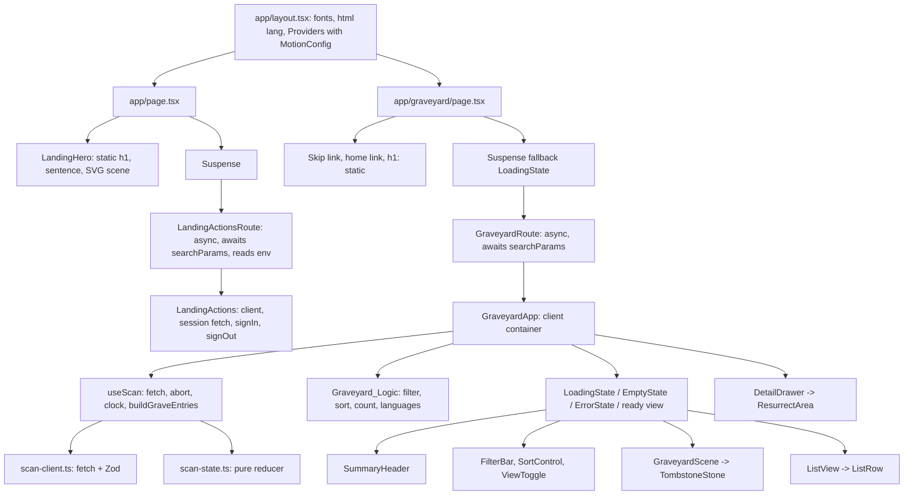
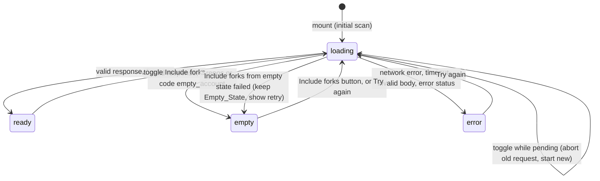
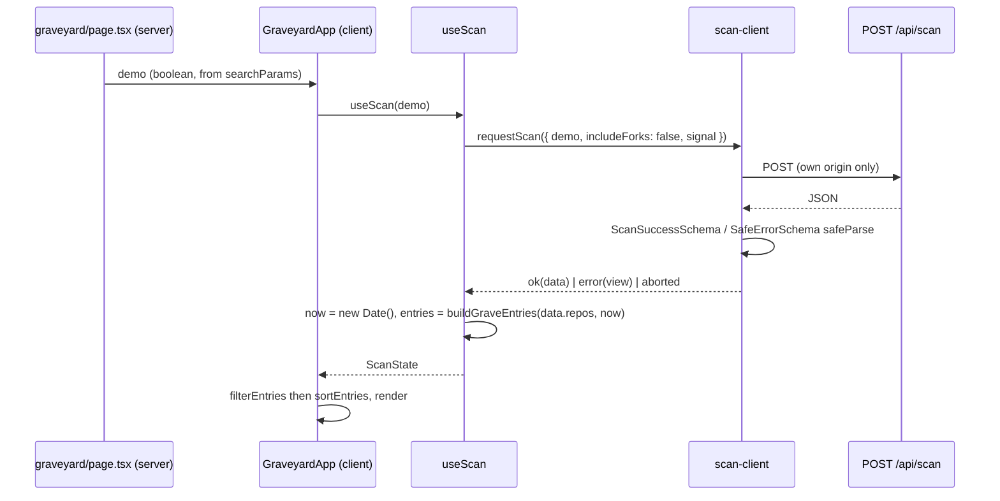

# Design Document

## Overview

This feature adds the two pages of Repo Graveyard: a landing page (`/`) and a graveyard page (`/graveyard`). The graveyard page calls `POST /api/scan`, turns every returned `RepoHealth` into a `Grave_Entry` (repo plus `Tombstone`), and shows the entries as tombstones in a scene or as a plain list. A detail drawer shows every fact about one repo and holds a placeholder Resurrect button.

The design has three layers:

- **Pure Graveyard_Logic** in `src/lib/graveyard/`. No I/O, no clock, no randomness. It holds entry building, counting, filtering, sorting, stone size, fog count, lifespan text, accessible text, the safe-link check, and scan error classification. This layer carries the correctness properties.
- **A thin client shell**: a fetch wrapper (`scan-client.ts`), a pure reducer (`scan-state.ts`) and one hook (`use-scan.ts`). It is the only code that touches `fetch`, `AbortController` and the clock.
- **Presentational components** in `src/components/`. They receive finished data as props. They do no fetching and no scoring.

The two route files are Server Components and read only request data (`searchParams`, environment). Everything interactive is a Client Component below them.

### Resolved open questions

| Question | Decision | Rationale |
|---|---|---|
| Years of life (`createdAt`) | `formatLifespan` takes `{ lastCommitAt, createdAt? }`. Version 1 shows **"Last commit {year}"**, because `RepoHealth` (a Zod `strictObject` in auth-ingestion) has no `createdAt`. The function already implements the full-range rules (Requirement 4, criteria 3 and 4), so the day `RepoHealth` gains an optional `createdAt`, the UI shows "2019 to 2023" with no UI change. | The UI must not invent a first-commit year. Passing a `RepoHealth` where `createdAt` is absent type-checks, because the parameter is optional. |
| Recommended follow-up (not done here) | Ask auth-ingestion to add `createdAt: iso datetime nullable` to `RepoHealth`, filled from the repository list payload's `created_at`. That payload is already fetched, so it costs no extra request. | Note: `created_at` is the repository creation date, not the first commit date. The label would read "Created {year}" in that case. See "Open points". |
| Where scoring runs | **In the browser, at the page boundary**, inside `useScan`, by calling `buildGraveEntries(repos, now)` once per accepted response. The clock is read once, there (`new Date()` in the hook), and passed in as `now`. | The scan response schema is fixed by auth-ingestion and carries `RepoHealth` only. Scoring is pure, deterministic, and holds no secret, so running it on the client produces the same result as on the server and needs no new route or response field. Components stay free of scoring logic (tech rule). |
| Scan response field names | Taken from the auth-ingestion design: success is `{ mode, repos, skippedForks, skippedInvalid, truncated, code?, stale?, cachedAt?, resetAt? }`. Failure is `{ error: { code, message, resetAt? } }`. | Imported from `@/lib/scan/response` (`ScanSuccessSchema`, `SafeErrorSchema`). Not redefined. |
| Landing session check | A small client fetch of `GET /api/auth/session`, validated with Zod, picks the signed-in or signed-out layout. | auth-ingestion keeps the access token out of the session. The route returns `{ user: { login, image }, expires }` or `{}`. No `SessionProvider` is needed. |
| Sign-in availability | The server page reads `readAuthEnv(process.env)` at request time and passes `signInAvailable` to the client. | The value must not be frozen into a prerendered shell (see "Next.js conventions"). |
| Drawer implementation | A custom `role="dialog"` panel with an explicit focus trap, the page behind it set `inert`, and Framer Motion for enter and exit. Not the native `<dialog>`. | Requirement 11.8 requires Tab to wrap from last to first element inside the drawer. A native modal dialog can hand focus to browser chrome instead. |
| `font-display` (typography token) vs next/font variable | next/font exposes `--font-cinzel` and `--font-inter`. The design tokens `--font-display` and `--font-body` are defined in CSS from those. | A next/font variable named `--font-display` would make `@theme` define `--font-display: var(--font-display)`, a circular reference. |

### Research findings that shaped the design

All Next.js statements below come from the installed docs in `node_modules/next/dist/docs/01-app/01-getting-started/`.

- **`searchParams` and dynamic rendering** (`03-layouts-and-pages.md`): a Server Component page reads `searchParams` as a `Promise`, and doing so makes the page dynamic. The docs recommend the `searchParams` prop when the params load data, and `useSearchParams` when they are used only on the client. `PageProps<'/route'>` is a global helper type that needs no import.
- **Cache Components** (`08-caching.md`, `cacheComponents: true` is set in `next.config.ts`): runtime data such as `searchParams`, cookies or `process.env` must be read under a `<Suspense>` boundary. The fallback ships in the prerendered shell and the dynamic part streams in. Reading `process.env` or `searchParams` outside Suspense is an error or is frozen at build time. This is why both route files render static content first and put the dynamic part inside `<Suspense>`.
- **Server and Client Components** (`05-server-and-client-components.md`): `"use client"` marks a boundary, and everything the file imports joins the client bundle. Interactive components are small client files. Route files stay on the server.
- **Fonts** (`13-fonts.md`): `next/font/google` self-hosts the font files at build time, supports variable fonts (recommended, no `weight` needed), `subsets`, `variable`, `display` and `fallback`. By default it also adjusts the fallback font metrics, which keeps layout shift small when the real font loads.
- **Route Handlers** (`15-route-handlers.md`): `POST /api/scan` already exists (auth-ingestion). This feature adds no route.
- **`inert`**: React 19 accepts a boolean `inert` prop. It removes the subtree from focus order and the accessibility tree, and blocks pointer input. This isolates the page behind the drawer.
- **Framer Motion**: `MotionConfig reducedMotion="user"` turns off transform and layout animation when the user prefers reduced motion, and keeps opacity. `LazyMotion` with `domAnimation` and the `m` component keep the landing bundle small. The installed version is `^14.14.0` in `package.json`. The names above exist in current Framer Motion releases, and the implementer should confirm them against the installed package before coding.
- **Tailwind CSS 4**: tokens go in `@theme`. `--spacing-*: initial` removes the default spacing scale, so a class such as `p-5` produces no CSS. This enforces the 4px scale from the design system. Content was rephrased for compliance with licensing restrictions.
- **Steering rules applied**: tokens only, no raw colors; display font at 20px or larger; body text at least 16px; motion on `opacity` and `transform` only; every decoration maps to a data field; status never by color alone; the plain list view is equivalent to the scene (design-system.md). Dark humor kind to the user, "paused, not failed" (product.md). No GitHub or LLM calls from the client, Zod on every external response, named exports (tech.md).

### Design decisions that depart from or refine the requirements

1. **Language filter value.** The requirements say `language` is `null` for "no filter". "Unknown language" also needs its own value. The design uses a union, `LanguageFilter = { kind: "all" } | { kind: "unknown" } | { kind: "named"; value: string }`. `{ kind: "all" }` is the requirements' `null`.
2. **Interactive borders use `--color-text-muted`, not `--color-border`.** `--color-border` on `--color-bg` is about 1.7:1, below the 3:1 required for component boundaries (Requirement 17.1). Controls (toggles, selects, buttons, the drawer panel edge) use `--color-text-muted` for borders (about 7.7:1 on `--color-surface`). `--color-border` is kept for dividers and for the decorative stone outline only.
3. **Summary header and failed scans.** Requirement 3.4 hides the Summary_Header while loading. Requirement 8.8 shows an "unavailable" text when the scan failed. The design hides it while loading and in the Empty_State (13.8), and shows "Counts are unavailable right now." only in the Error_State.
4. **The "Include forks" control appears once.** The header switch is shown while loading and when entries are ready. The Empty_State has its own "Include forks" button (13.5) and the header switch is hidden there, so two controls never share a name. The Error_State shows neither.
5. **Epitaph font.** In the scene caption the epitaph uses the body font at 16px (an 80 character line at 20px would not fit a 192px caption). In the drawer it uses the display font at 20px.
6. **"Outdated dependencies" wording.** The required strings stay ("outdated dependencies", "Outdated"). The drawer adds a one-line note, "Outdated means package.json has not changed for over a year", so the label stays honest about the auth-ingestion proxy.
7. **Failed scans keep the last good data in memory** (Requirement 1.7), but the Error_State is what the user sees. "Try again" always sends a fresh request.
8. **No avatar is shown.** The GitHub avatar is never rendered, so the pages request no raster image at all (Requirement 18.1).

## Architecture

### Route and component structure



### Scan state machine



### Data flow



### Next.js conventions applied

- `layout.tsx` stays the root layout. It replaces the Geist fonts with Cinzel and Inter, sets `<html lang="en">` and wraps children in `Providers` (a client file holding `MotionConfig reducedMotion="user"`, Requirement 16.4). It also sets `export const metadata` with the app title and description.
- `app/page.tsx` and `app/graveyard/page.tsx` use `export default` because Next requires it (tech rule). Everything else uses named exports.
- Both pages render their static part (hero or header) outside `<Suspense>`, and the dynamic part inside it:

```tsx
// app/graveyard/page.tsx (server)
export default function Page(props: PageProps<"/graveyard">) {
  return (
    <>
      <a href="#graveyard-main" className="skip-link">Skip to graveyard</a>
      <header>{/* home link */}</header>
      <main id="graveyard-main" tabIndex={-1}>
        <h1 id="page-heading" tabIndex={-1}>The Graveyard</h1>
        <Suspense fallback={<LoadingState />}>
          <GraveyardRoute searchParams={props.searchParams} />
        </Suspense>
      </main>
    </>
  );
}
async function GraveyardRoute({ searchParams }: { searchParams: Promise<Record<string, string | string[] | undefined>> }) {
  const demo = parseDemoFlag((await searchParams).demo);   // pure: "1" only
  return <GraveyardApp demo={demo} />;
}
```

`parseDemoFlag(value)` returns true only for the single string `"1"`. It is in Graveyard_Logic with tests. The same shape is used by the landing page, which also awaits `searchParams` for the sign-in `error` value and calls `readAuthEnv(process.env)` inside the Suspense child, so the value is read per request.

- The `searchParams` prop is used, not `useSearchParams`, because the value decides which request the client sends, and this avoids a client Suspense requirement.
- Client files that import `next-auth/react` (`signIn`, `signOut`) are `landing-actions.tsx` only. Nothing in `src/components/graveyard/` imports it.
- **Dev note:** React Strict Mode runs effects twice in `next dev`. `useScan` aborts the first request in its cleanup, so one request completes, but the network panel shows two. The "exactly one request" end-to-end tests run against `next build` plus `next start`.

### Module layout

```
src/
  app/
    layout.tsx                      # fonts, html lang, Providers
    globals.css                     # tokens, @theme, keyframes, base styles
    page.tsx                        # landing (server)
    graveyard/page.tsx              # graveyard (server)
  components/
    providers.tsx                   # "use client": MotionConfig
    landing/
      landing-hero.tsx              # server-safe, static
      landing-actions.tsx           # "use client"
    graveyard/
      graveyard-app.tsx             # "use client": container, view state
      summary-header.tsx
      filter-bar.tsx
      sort-control.tsx
      view-toggle.tsx
      include-forks-switch.tsx
      graveyard-scene.tsx
      scene-defs.tsx                # shared SVG <symbol> definitions
      tombstone-stone.tsx           # memo
      stone-decor.tsx               # FogLayers, Candle, Cracks, Vines
      list-view.tsx
      status-badge.tsx              # icon + label
      status-icon.tsx               # four distinct shapes
      detail-drawer.tsx
      resurrect-area.tsx
      loading-state.tsx
      empty-state.tsx
      error-state.tsx
      stale-notice.tsx
  lib/graveyard/                    # pure logic (Vitest + fast-check, tests next to code)
    types.ts                        # GraveEntry, Filters, SortOrder, ScanState, ...
    entries.ts                      # buildGraveEntries
    status.ts                       # STATUSES, statusLabel, countByStatus, formatSummary
    filter.ts                       # filterEntries, listLanguages, reconcileFilters
    sort.ts                         # SORT_OPTIONS, sortEntries
    stone.ts                        # stoneSize, fogLayerCount, MAX_ANIMATED_STONES
    text.ts                         # buildAccessibleName, describeFacts, plural
    dates.ts                        # parseIsoDate, formatLifespan, formatUtcDate, formatUtcTime, formatUtcDateTime
    detail.ts                       # buildDetailRows, ciLabel, depsLabel, safeRepoLink
    copy.ts                         # every user-facing sentence from Requirements 2, 13, 14
    scan-errors.ts                  # classifyScanError, ScanErrorView
    scan-state.ts                   # scanReducer, settleSuccess
    scan-client.ts                  # requestScan (the only fetch)
    use-scan.ts                     # "use client" hook
    session.ts                      # SessionResponseSchema, readSession
    sign-in-error.ts                # classifySignInError, parseDemoFlag
e2e/
  graveyard-ui.spec.ts, landing.spec.ts, fixtures/scan-fixtures.ts
```

`src/lib/graveyard` imports `RepoHealth` and `Tombstone` as types, and `scoreRepo`, `TombstoneSchema` as values from `@/lib/scoring`, `ScanSuccessSchema`, `SafeErrorSchema` from `@/lib/scan/response`, and `compareCodePoint` from `@/lib/github/sort`. It defines none of them again.

## Components and Interfaces

### Design tokens (`src/app/globals.css`)

The palette from design-system.md is defined once, in `@theme static` so every variable is always emitted on `:root`. Tailwind then generates matching utilities (`bg-bg`, `bg-surface`, `bg-surface-raised`, `text-text`, `text-text-muted`, `text-glow`, `text-ember`, `border-border`). The default color, spacing and radius namespaces are cleared, so a class outside the design system generates nothing.

```css
@import "tailwindcss";

@theme static {
  --color-*: initial;
  --color-bg: #0a0f1f;
  --color-surface: #121a31;
  --color-surface-raised: #1b2542;
  --color-border: #2c3860;
  --color-text: #ebe6d6;
  --color-text-muted: #a8adc0;
  --color-glow: #b79cff;
  --color-glow-soft: rgb(183 156 255 / 0.25);
  --color-ember: #ff7a45;
  --color-ember-soft: rgb(255 122 69 / 0.25);
  --color-focus: var(--color-glow);

  --radius-*: initial;
  --radius-sm: 6px;
  --radius-md: 12px;
  --radius-lg: 20px;
  --radius-tomb: 40% 40% 6px 6px / 28% 28% 6px 6px;
  --radius-full: 9999px;
}

:root {
  --space-1: 4px;  --space-2: 8px;  --space-3: 12px; --space-4: 16px;
  --space-6: 24px; --space-8: 32px; --space-12: 48px; --space-16: 64px;
  --motion-fast: 200ms; --motion-base: 400ms;
  --motion-fog: 6000ms; --motion-candle: 2400ms;
  --ease: ease-in-out;
  --stone-cell: 12rem;           /* width of one scene cell, a layout size, not a spacing value */
  color-scheme: dark;            /* dark only, no prefers-color-scheme rule anywhere */
}

@theme inline {
  --spacing-*: initial;
  --spacing-1: var(--space-1);  --spacing-2: var(--space-2);  --spacing-3: var(--space-3);
  --spacing-4: var(--space-4);  --spacing-6: var(--space-6);  --spacing-8: var(--space-8);
  --spacing-12: var(--space-12); --spacing-16: var(--space-16);
  --font-display: var(--font-cinzel), serif;
  --font-body: var(--font-inter), sans-serif;
}
```

Base styles: `body` uses `font-body`, 16px, line height 1.5, `bg-bg`, `text-text`. A global `:focus-visible` rule sets `outline: 2px solid var(--color-focus); outline-offset: 2px`. Layout wrappers that hold focusable children never set `overflow: hidden`, so rings are not clipped. The scene container has `--space-2` padding so a ring at its edge is visible.

A `.sr-only` utility (Tailwind's) hides text visually and keeps it in the accessibility tree. It is used for the `describeFacts` text and for the comma separators in the summary.

### Fonts (`layout.tsx`)

```tsx
const cinzel = Cinzel({ subsets: ["latin"], variable: "--font-cinzel", display: "swap", fallback: ["serif"] });
const inter  = Inter({  subsets: ["latin"], variable: "--font-inter",  display: "swap", fallback: ["sans-serif"] });
// <html lang="en" className={`${cinzel.variable} ${inter.variable}`}>
```

Both fonts are variable fonts, so no `weight` is passed. The CSS stacks end in `serif` and `sans-serif`, so text stays visible with the fallback (Requirement 15.3). next/font downloads and self-hosts the files at build time. A failure in `next dev` falls back with a console warning, and the production build needs network access once. The display font is used only with classes of `text-xl` (20px) or larger. A static test enforces this (see Testing Strategy).

### Providers (`components/providers.tsx`)

```tsx
"use client";
export function Providers({ children }: { children: ReactNode }) {
  return <MotionConfig reducedMotion="user">{children}</MotionConfig>;
}
```

`LazyMotion` with `domAnimation` is added inside `DetailDrawer` and the Stale_Notice only, so the landing bundle carries `MotionConfig` and nothing else from Framer Motion. If the landing page exceeds the 200 kB budget (Requirement 18.2), the check script from the Testing Strategy reports it.

### Graveyard_Logic: types (`types.ts`)

```ts
import type { RepoHealth } from "@/lib/github/repo-health";
import type { Tombstone, Status } from "@/lib/scoring";
import type { ScanSuccess } from "@/lib/graveyard/scan-client";   // z.infer of ScanSuccessSchema

export type GraveEntry = { repo: RepoHealth; tombstone: Tombstone };
export type LanguageFilter =
  | { kind: "all" } | { kind: "unknown" } | { kind: "named"; value: string };
export type Filters = { statuses: readonly Status[]; language: LanguageFilter };
export type SortOrder = "score-desc" | "score-asc" | "name-asc" | "stars-desc" | "silence-desc";
export type ViewMode = "scene" | "list";
export const NO_FILTERS: Filters = { statuses: [], language: { kind: "all" } };
```

`GraveEntry` has exactly the two fields (Requirement 1.1). `Status` and `Tombstone` come from the death-scoring design. The entry key in lists is `repo.url`, which is unique per scan.

### Graveyard_Logic: functions

All are named exports, pure, and total (they never throw for any input of their declared type).

| Function | Signature | Behavior |
|---|---|---|
| `buildGraveEntries` | `(repos: readonly RepoHealth[], now: Date) => GraveEntry[]` | `repos.map(repo => ({ repo, tombstone: scoreRepo(repo, now) }))`. Same length and order. Empty in gives empty out. |
| `STATUSES` | `readonly ["alive","dying","dead","ancient"]` | Fixed display and count order. |
| `statusLabel` | `(status: Status) => string` | "Alive", "Dying", "Dead", "Ancient". |
| `countByStatus` | `(entries: readonly GraveEntry[]) => Record<Status, number>` | One pass. Counts sum to `entries.length`. |
| `formatSummary` | `(counts) => string` | `"{a} alive, {b} dying, {c} dead, {d} ancient"`, zeros included. |
| `filterEntries` | `(entries, filters: Filters) => GraveEntry[]` | Keeps entries whose status is in `statuses` (all when empty) and whose language matches (`all`: every entry, `unknown`: `language === null`, `named`: `language === value`, case-sensitive). Original relative order. Returns a new array, never mutates. |
| `listLanguages` | `(entries) => { languages: string[]; hasUnknown: boolean }` | Distinct non-null languages sorted by `compareCodePoint`. `hasUnknown` is true when at least one entry has a null language. |
| `reconcileFilters` | `(filters, entries) => Filters` | After a re-scan: if a `named` language no longer appears (or `unknown` has no match), reset the language to `all`. Statuses are kept. |
| `SORT_OPTIONS` | `ReadonlyArray<{ value: SortOrder; label: string }>` | The five options of Requirement 9.8, in order, default `score-desc`. |
| `sortEntries` | `(entries, order: SortOrder) => GraveEntry[]` | Copy, then sort by the key (see below), tie-break by `repo.name` (`compareCodePoint`) then `repo.url`. Never mutates. |
| `stoneSize` | `(stars: unknown) => { width: number; height: number }` | See below. |
| `MAX_ANIMATED_STONES` | `60` | Loop animation cutoff. |
| `fogLayerCount` | `(fog: unknown) => 0 \| 1 \| 2 \| 3` | Exact lookup: 0 gives 0, 0.33 gives 1, 0.66 gives 2, 1 gives 3. Anything else gives 0. |
| `buildAccessibleName` | `(entry) => string` | `"{name}, {Status}, {cause.label}"`. See below. |
| `describeFacts` | `(entry) => string` | See below. |
| `formatLifespan` | `(input: { lastCommitAt: string \| null; createdAt?: string \| null }) => string` | See below. |
| `parseIsoDate` | `(value: unknown) => Date \| null` | Accepts only ISO 8601 strings with a zone (same pattern as scoring), rejects `Date.parse` leniency such as `"March 3 2024"`, and rejects `NaN`. |
| `formatUtcDate` / `formatUtcTime` / `formatUtcDateTime` | `(iso: unknown) => string \| null` | `YYYY-MM-DD`, `HH:mm`, `YYYY-MM-DD HH:mm` in UTC, or `null` when invalid. Built from `getUTC*` getters, never from `toLocale*`, so the time zone cannot matter. |
| `safeRepoLink` | `(url: string) => string \| null` | Returns the parsed `href` only when the scheme is `https:`, the hostname is exactly `github.com`, the port is empty, and there is no username or password. Otherwise `null`. |
| `buildDetailRows` | `(entry) => DetailRow[]` | Label and value strings for the drawer (see below). |
| `parseDemoFlag` | `(value: unknown) => boolean` | True only for the string `"1"`. |
| `classifySignInError` | `(value: unknown) => "cancelled" \| "failed" \| null` | Absent or empty gives `null`. `"AccessDenied"` gives `"cancelled"`. Any other string gives `"failed"`. The raw value is never rendered. |

**`stoneSize(stars)`**

1. `s = Number.isInteger(stars) && stars >= 0 ? stars : 0`. This rejects `NaN`, both infinities, `null`, `undefined`, fractions, negatives and non-numbers (`Number.isInteger` is false for all of them).
2. `t = Math.min(Math.log10(1 + s) / Math.log10(1001), 1)`.
3. `width = Math.round(96 + t * 64)`; `height = Math.round(width * 1.25)`.

`Math.round` rounds halves up, which equals "away from zero" for positive values. The width is in 96 to 160, so the height is in 120 to 200. For `s = 1000`, `t` is exactly 1 (the same number divided by itself). Reference values used in unit tests: 0 gives 96 x 120, 1 gives 102 x 128, 10 gives 118 x 148, 100 gives 139 x 174, 1000 and 1,000,000 give 160 x 200. `Math.log10` is monotonic, so the width never decreases as stars grow.

**`sortEntries` keys**

| Order | Primary key |
|---|---|
| `score-desc` | `tombstone.score` descending |
| `score-asc` | `tombstone.score` ascending |
| `name-asc` | `repo.name` by code point ascending |
| `stars-desc` | `repo.stars` descending |
| `silence-desc` | `tombstone.daysInactive` descending, `null` larger than any number |

The comparator is a total order whenever names and URLs are distinct, so the result does not depend on input order.

**`buildAccessibleName`**: `name = repo.name.trim() === "" ? "Unnamed repository" : repo.name`. The cause segment is added only when `cause.label.trim() !== ""`. Parts are joined with `", "`, so there is never a trailing comma. The function never interpolates a value that can be `undefined` or `null`.

**`describeFacts`** returns parts in a fixed order, joined by `", "`:

1. Inactivity: `Inactive {plural(daysInactive, "day")}`, or `No commits recorded` when `daysInactive` is `null`.
2. `CI failing`, only when `scene.cracks` is true.
3. `outdated dependencies`, only when `scene.vines` is true.
4. Stars: `plural(stars, "star")` where `stars` is `repo.stars` when it is a non-negative integer, else 0.

`plural(n, noun)` gives `"1 day"` for exactly 1 and `"{n} days"` otherwise, including 0.

**`formatLifespan`** (years use `getUTCFullYear`, padded to four digits):

| `createdAt` valid | `lastCommitAt` valid | Result |
|---|---|---|
| yes | yes | `"{c} to {l}"`, or `"{c}"` when equal |
| yes | no | `"{c}"` |
| no | yes | `"Last commit {l}"` |
| no | no | `"No commits recorded"` |

**`buildDetailRows`** returns an ordered list of `{ label, value }`. Values are plain strings: Status, `"{score} of 100"`, Cause, Epitaph, Lifespan, Last commit (`YYYY-MM-DD` UTC or "No commits recorded"), Activity (`describeFacts`), Open issues, CI (`ciLabel`: "Passing", "Failing", "No CI"), Dependencies (`depsLabel`: "Outdated", "Up to date", "Unknown"), README ("Has README" or "No README"), Stars, Language (or "Unknown language"), Archived ("Archived" or "Not archived"), Description (or "No description").

### Scan errors (`scan-errors.ts`)

```ts
export type ScanErrorView =
  | { kind: "token_revoked" } | { kind: "unauthorized" }
  | { kind: "rate_limited"; resetAt?: string }
  | { kind: "not_found" } | { kind: "sealed" } | { kind: "generic" };
export function classifyScanError(status: number | null, body: unknown): ScanErrorView;
```

`classifyScanError` parses `body` with `SafeErrorSchema.safeParse`. If parsing fails, or `status` is `null`, the result is `generic`. Otherwise `(status, code)` must match this table exactly, and any other pair is `generic`:

| Status and code | View |
|---|---|
| 401 `token_revoked` | `token_revoked` |
| 401 `unauthorized` | `unauthorized` |
| 429 `rate_limited` | `rate_limited`, with `resetAt` only when `Date.parse` of the field is finite |
| 404 `account_not_found` | `not_found` |
| 503 `auth_not_configured` or `demo_unavailable` | `sealed` |
| 403 `forbidden`, 502 `github_unavailable` or `invalid_github_response`, 500 `internal_error`, 400 `validation_error` | `generic` |

Only the `kind` (and a validated `resetAt`) leaves this function. The response `message`, the status and the raw body are dropped, so they cannot be displayed (Requirement 14.13).

### Copy (`copy.ts`)

Every user-facing sentence from Requirements 2, 13 and 14 is a constant here, so one test can check them all for banned words (14.14). Examples:

```ts
export const COPY = {
  loading: "Fog is rolling in. Counting graves…",
  emptyHeading: "No graves here",
  emptyBody: "Every repo is still alive, or none have been laid down yet.",
  staleNotice: (time: string) => `GitHub asked us to rest. Showing the graveyard as of ${time}.`,
  staleReset: (time: string) => `You can try again after ${time}`,
  tokenRevoked: "GitHub closed the door on our key. Sign in again to reopen the graveyard.",
  unauthorized: "Sign in to open your graveyard, or wander through the demo one.",
  rateLimited: "GitHub needs a moment to rest. Try again soon.",
  notFound: "We could not find this graveyard.",
  sealed: "This door is sealed for now.",
  generic: "Something spooked the gate. Nothing is lost, only paused. Try again in a moment.",
  signInCancelled: "You left the gate unopened. Your repos are only paused. Try again any time.",
  signInFailed: "The gate would not open. Your repos are only paused. Try again.",
  signInUnavailable: "Sign-in is resting right now. The demo graveyard is open.",
  // ...
} as const;
```

The sign-in messages replace the plainer auth-ingestion Safe_Error texts on this page (Requirement 2.8 asks for the product voice and at most 140 characters). Copy about the owner uses "your repos", never a judgment of the owner.

### Scan client (`scan-client.ts`)

```ts
export type ScanSuccess = z.infer<typeof ScanSuccessSchema>;
export type ScanResult =
  | { kind: "ok"; data: ScanSuccess }
  | { kind: "error"; error: ScanErrorView }
  | { kind: "aborted" };
export const SCAN_TIMEOUT_MS = 30_000;
export async function requestScan(args: {
  demo: boolean; includeForks: boolean; signal: AbortSignal; fetchImpl?: typeof fetch;
}): Promise<ScanResult>;
```

Behavior:

1. Sends `POST /api/scan` (a relative URL, so only the app's own origin) with `content-type: application/json` and body `{ demo: true, includeForks }` in demo mode or `{ includeForks }` otherwise. No username is ever sent (3.3).
2. The request signal is `AbortSignal.any([args.signal, AbortSignal.timeout(30_000)])`.
3. On `res.ok`: reads JSON, then `ScanSuccessSchema.safeParse`. Success gives `ok`. A parse or JSON failure gives `{ kind: "error", error: { kind: "generic" } }`, and nothing from the body is logged or returned.
4. On a non-OK status: reads JSON if possible and returns `classifyScanError(res.status, body)`.
5. A thrown error: if `args.signal.aborted` the result is `aborted` (the hook ignores it). Any other throw (network error or the 30 s timeout) gives `generic`.
6. It never calls `console.*` and never rethrows.

`fetchImpl` is injected only so Vitest can test every branch without a network.

### Scan state (`scan-state.ts`)

```ts
export type ScanOrigin = "initial" | "toggle" | "retry" | "empty-action";
export type ScanMeta = Omit<ScanSuccess, "repos">;
export type ScanState =
  | { phase: "loading"; includeForks: boolean; origin: ScanOrigin; previous: SettledState | null }
  | { phase: "ready"; includeForks: boolean; entries: GraveEntry[]; meta: ScanMeta }
  | { phase: "empty"; includeForks: boolean; meta: ScanMeta; retryFailed: boolean }
  | { phase: "error"; includeForks: boolean; error: ScanErrorView };
export type SettledState = Exclude<ScanState, { phase: "loading" }>;
export type ScanAction =
  | { type: "started"; includeForks: boolean; origin: ScanOrigin }
  | { type: "succeeded"; data: ScanSuccess; now: Date }
  | { type: "failed"; error: ScanErrorView };
export function scanReducer(state: ScanState, action: ScanAction): ScanState;
export function settleSuccess(data: ScanSuccess, includeForks: boolean, now: Date): SettledState;
```

- `settleSuccess` returns `empty` when `data.repos.length === 0` or `data.code === "empty_account"`, **without calling `buildGraveEntries`** (3.6). Otherwise it calls `buildGraveEntries(data.repos, now)` once and returns `ready` (3.5).
- `started` moves to `loading` and remembers the last settled state in `previous` (a `loading` state's own `previous` is carried forward, so repeated toggles do not lose it).
- `failed` moves to `error`, except when `origin` is `empty-action` and `previous` is an `empty` state. Then the state is that `empty` state with `retryFailed: true` (13.7).
- The reducer is pure. The clock is read in the hook and passed in as `now`.

### Scan hook (`use-scan.ts`)

```ts
"use client";
export function useScan(demo: boolean): {
  state: ScanState;
  setIncludeForks: (value: boolean) => void;   // origin "toggle"
  includeForksFromEmpty: () => void;           // origin "empty-action", includeForks true
  retry: () => void;                           // origin "retry", same includeForks
};
```

It owns one `AbortController` in a ref. `run(origin, includeForks)` aborts the previous controller, dispatches `started`, awaits `requestScan`, ignores `aborted`, then dispatches `succeeded` (with `now = new Date()`, the only clock read) or `failed`. A mount effect runs the first scan with `includeForks: false` (origin `initial`). Its cleanup aborts the controller, which handles Strict Mode and unmount. A response that arrives after its controller was aborted is dropped (3.14).

### Landing components

**`LandingHero`** (static, server-safe): one `h1` ("Repo Graveyard"), one sentence (under 140 characters: "See your abandoned GitHub repos as tombstones, then decide which ones deserve a second life."), and a decorative inline SVG hill and moon, plus at most 3 CSS fog layers, all `aria-hidden="true"`. No raster image.

**`LandingActionsRoute`** (async server): awaits `searchParams`, computes `classifySignInError(sp.error)` and `signInAvailable = readAuthEnv(process.env) !== null`, and renders `<LandingActions signInError signInAvailable />`.

**`LandingActions`** (client):

```ts
type Props = { signInError: "cancelled" | "failed" | null; signInAvailable: boolean };
```

- On mount it fetches `/api/auth/session` and parses it with `SessionResponseSchema = z.object({ user: z.object({ login: z.string().min(1) }) }).partial()`-style schema. A fetch or parse failure is treated as signed out. State: `checking | signedIn | signedOut`. While `checking` it shows the signed-out layout (sign-in is harmless when already signed in), then switches without layout shift because both layouts reserve the same row.
- Signed out: "Sign in with GitHub" (`signIn("github", { callbackUrl: "/graveyard" })`, disabled with `signInUnavailable` text when `signInAvailable` is false) and "Try demo graveyard" (a `Link` to `/graveyard?demo=1`). That is exactly two primary buttons.
- Signed in: an "Open my graveyard" link to `/graveyard`, a sign-out button (`signOut({ redirect: false })`, then state becomes `signedOut` within 2 s), and the demo button. No sign-in button.
- Error indicator: when `signInError` is set, a `role="alert"` message from `COPY` and a "Try again" button that calls `signIn` again. No raw code is shown.
- Every button and link has `min-h-[44px] min-w-[44px]` through a shared `button-base` class (see Accessibility).

### Graveyard components

**`GraveyardApp`** (client container). Holds view state with `useState`: `filters` (default `NO_FILTERS`), `sortOrder` (`score-desc`), `view` (`scene`), `selectedUrl` (`string | null`). It calls `useScan(demo)` and then, for `ready`, derives with `useMemo`:

```ts
const counts   = countByStatus(entries);                       // all entries, ignores filters
const visible  = sortEntries(filterEntries(entries, filters), sortOrder);   // same array to scene and list
const langs    = listLanguages(entries);
```

Render by phase:

| Phase | Output |
|---|---|
| `loading` | `LoadingState`, the "Include forks" switch (so a pending toggle can be reversed), no Summary, Filter_Bar or Sort_Control |
| `ready` | demo badge, truncated/forks/invalid notes, `StaleNotice` when `meta.stale`, `SummaryHeader`, `IncludeForksSwitch`, `FilterBar`, `SortControl`, `ViewToggle`, then Scene or List, then `DetailDrawer` |
| `empty` | `EmptyState` only (with the link back to the landing page) |
| `error` | `ErrorState` and the "Counts are unavailable right now." status text |

A live region `<div role="status" aria-live="polite">` stays mounted in every phase. The Summary text is rendered inside it only in `ready`, so a change after a re-scan is announced (8.6).

While `filters` are active (non-empty statuses or a language other than `all`) the header shows `Showing {k} of {n}`. An effect calls `reconcileFilters` when `entries` change. When `visible` is empty and `entries` is not, the active view shows "No graves match these filters" and a "Clear filters" button (9.12, 9.13). The Filter_Bar stays mounted, so focus stays on the changed control (9.15).

**Drawer wiring.** `selectedUrl` is set by the stone or row `onOpen(url, openerElement)`. The opener element is kept in a ref. The page content (everything except the drawer) is wrapped in `<div inert={selected !== null}>`. A `useEffect` handles the close: when `selectedUrl` becomes `null`, it focuses the opener if it is still connected, or `#page-heading` if not. If `entries` change and `selectedUrl` is no longer found, the app sets it to `null` and focuses `#page-heading` (11.15).

**`SummaryHeader`**: props `{ counts; shown; total; filtered }`. It renders four chips (`StatusIcon` with `aria-hidden`, then text such as "14 alive"), with a visually hidden ", " between chips so the text content equals `formatSummary(counts)`.

**`FilterBar`**: four `aria-pressed` toggle buttons (labels from `statusLabel`, each with its icon), and a labelled `<select>`: "All languages", each language, then "Unknown language" only when `hasUnknown`. Option values are `"all"`, `"unknown"`, and `"lang:" + name`, which avoids a clash between a language called "unknown" and the unknown option.

**`SortControl`**: a labelled `<select>` built from `SORT_OPTIONS`.

**`ViewToggle`**: two buttons "Scene" and "List" with `aria-pressed`.

**`IncludeForksSwitch`**: a native checkbox in a label "Include forks", 44px high.

**`GraveyardScene`**: `<ul aria-label="Graveyard">` with `data-animate={visible.length <= MAX_ANIMATED_STONES}`, one `<li>` per entry in order, `flex flex-wrap gap-6 md:gap-8`. It renders `SceneDefs` once. DOM order equals sort order, so Tab order equals reading order.

**`SceneDefs`**: one hidden `<svg aria-hidden="true" width="0" height="0">` with `<symbol>` definitions for cracks, vines and the candle flame. Each stone references them with `<svg data-decor="cracks"><use href="#gy-cracks"/></svg>`. Path data therefore exists once, not once per stone (Requirement 18.6).

**`TombstoneStone`** (wrapped in `React.memo`; props `{ entry, onOpen }`; `onOpen` is a stable callback):

```tsx
<button type="button" className="stone-cell" data-status={status}
        aria-label={buildAccessibleName(entry)} aria-describedby={factsId}
        onClick={(e) => onOpen(repo.url, e.currentTarget)}>
  <span className="stone-halo" aria-hidden="true" />
  <span className="stone" style={{ width, height }}>        {/* from stoneSize(repo.stars) */}
    {Array.from({ length: fogLayerCount(scene.fog) }, (_, i) => <span key={i} className="fog-layer" style={{ "--i": i }} aria-hidden="true" />)}
    {scene.vines  && <svg data-decor="vines"  aria-hidden="true"><use href="#gy-vines" /></svg>}
    {scene.cracks && <svg data-decor="cracks" aria-hidden="true"><use href="#gy-cracks" /></svg>}
    {scene.candle && <svg data-decor="candle" aria-hidden="true"><use href="#gy-candle" /></svg>}
    <span className="stone-name">{repo.name}</span>
  </span>
  <span className="ground" aria-hidden="true" />
  <span className="stone-caption">
    <StatusBadge status={status} />
    <span>{formatLifespan(repo)}</span>
    <span>{cause.label}</span>
    <span className="epitaph">{epitaph}</span>
  </span>
  <span id={factsId} className="sr-only">{describeFacts(entry)}</span>
</button>
```

- The button is the stone (a focusable control, not a click-only div). Its accessible name is exactly `buildAccessibleName`, set through `aria-label`. The description is the visually hidden `describeFacts` span, which is not `aria-hidden`.
- The stone body gets `width` and `height` from `stoneSize` as inline pixel styles, so the box is fixed before fonts load. The button's cell is `--stone-cell` wide (12rem), so a caption can hold 4 to 6 lines of 16px text. The ground line is a 4px strip in `--color-border`.
- The name sits in the stone with `font-display text-xl`, clamped to 2 lines with an ellipsis (`line-clamp-2`, `overflow-wrap: anywhere`). Everything else sits in the caption, which wraps and never clips. The full name is in the accessible name and the drawer.
- The epitaph and every other string render as React text children. There is no `dangerouslySetInnerHTML` anywhere (Requirement 4.9), enforced by lint.
- The hover and focus effect is the `stone-halo` layer. Its `opacity` goes from 0 to 1 over `--motion-fast` (200ms). `box-shadow` and `border` do not change, so the hit area does not move (16.10). The halo color is `--color-glow-soft` for `alive` and `dying`, and `--color-ember-soft` for `dead` and `ancient`.
- Status label color: `text-glow` for `alive`, `text-ember` for the others, always with the text and the icon (4.10).

**Decorations** (`stone-decor.tsx` and CSS):

| Element | Data | Rendering |
|---|---|---|
| Fog layer (1 to 3) | `scene.fog` through `fogLayerCount` | `span.fog-layer`, `aria-hidden`, `pointer-events: none`, `background: radial-gradient` of `--color-text-muted`, layer `opacity` at most 0.12. Layer index `--i` offsets position and animation delay. |
| Candle | `scene.candle` | `svg[data-decor="candle"]`, flame filled with `--color-glow`, flickers with `opacity` and `transform: scaleY`. |
| Cracks | `scene.cracks` | `svg[data-decor="cracks"]`, strokes in `--color-ember`. One fixed density (death-scoring gives a boolean). |
| Vines | `scene.vines` | `svg[data-decor="vines"]`, strokes in `--color-text-muted`. One fixed density. |
| Stone | `repo.stars` | Width and height from `stoneSize`. |
| Ground | none | A baseline strip. It carries no data and is the single allowed non-data element beside the stone itself (6.14). |

Fog and candle animation in `globals.css`:

```css
@keyframes fog-drift   { from { transform: translateX(-8%); opacity: 0.06; } to { transform: translateX(8%); opacity: 0.12; } }
@keyframes candle-flicker { from { transform: scaleY(0.92); opacity: 0.85; } to { transform: scaleY(1.05); opacity: 1; } }

.fog-layer    { animation: fog-drift var(--motion-fog) var(--ease) infinite alternate; animation-delay: calc(var(--i) * -2000ms); }
.candle-flame { animation: candle-flicker var(--motion-candle) var(--ease) infinite alternate; }

[data-animate="false"] .fog-layer, [data-animate="false"] .candle-flame { animation: none; }
@media (prefers-reduced-motion: reduce) {
  .fog-layer, .candle-flame, .loading-fog { animation: none; }
  /* static fog sits at its mid position, same layer count and density */
}
```

The flicker alternates every 2400ms, so brightness changes at most about 0.8 times per second, below the 3 per second limit. The fog loop is 6000ms. The `data-animate="false"` branch applies above 60 stones and keeps every element in the DOM (6.11). The reduced-motion branch is a CSS media query, so it reacts to a setting change at once, with no reload (16.8). Each fog layer overlays only the stone, with a combined opacity under 0.32, which keeps the stone name above 6:1 contrast (see Accessibility). The caption sits outside the fog.

**`ListView`**: a `<ul aria-label="Graveyard list">`. Each row has a native `button` (accessible name from `buildAccessibleName`) and text for name, status badge, `"{score}/100"`, cause label, epitaph, lifespan and `plural(stars, "star")`. It uses the same `visible` array as the scene.

**`StatusIcon`**: four distinct inline SVG shapes. `alive` is a circle, `dying` a downward triangle, `dead` a square, `ancient` a diamond. `StatusBadge` pairs the icon with the `statusLabel` text and the color class.

**`DetailDrawer`** (client). Props `{ entry: GraveEntry | null; onClose; }`.

- Rendered with `AnimatePresence` inside `LazyMotion`. The panel uses `role="dialog" aria-modal="true" aria-labelledby={headingId}`, and its name is the repo name (the `h2` heading, `tabIndex={-1}`).
- On open, an effect focuses the heading. A `keydown` handler on the panel traps Tab: on Tab from the last focusable element it focuses the first, and on Shift+Tab from the first it focuses the last. Escape calls `onClose`. A full-screen backdrop `div` (`aria-hidden`) closes on click.
- Layout: below `md`, a bottom sheet (`fixed inset-x-0 bottom-0`, `max-h-[85vh]`, `overflow-y-auto`, full width). From `md` up, a right panel (`fixed inset-y-0 right-0 w-[420px]`, `overflow-y-auto`). Mobile-first classes with `md:` overrides only.
- While open, an effect sets `document.body.style.overflow = "hidden"` and restores the previous value on cleanup (11.14).
- Content: a definition list from `buildDetailRows`, the note about the outdated label, the repo link when `safeRepoLink(repo.url)` is not `null` (`target="_blank" rel="noopener noreferrer"`, text "Open on GitHub"), the `ResurrectArea`, and a "Close" button of at least 44 x 44.
- Motion: enter and exit use `x` or `y` transform plus `opacity` over 400ms (`--motion-base`). With `useReducedMotion()` true, the transform is dropped and only a 150ms opacity fade remains (`MotionConfig` also disables the transform). The content is identical (11.16).

**`ResurrectArea`**: `({ entry }: { entry: GraveEntry })`. A button labelled "Resurrect" with `aria-disabled="true"` (no `disabled` attribute), `aria-describedby` pointing at the text "Revival plans are coming soon. This repo is only paused.", and an `onClick` that calls `event.preventDefault()` and nothing else. No request is sent and focus stays on the button. The component takes one `GraveEntry`, so a later spec can replace its body without touching the drawer.

**`LoadingState`**: `role="status"` with the loading text, and 1 to 3 `aria-hidden` `loading-fog` spans. Static under reduced motion.

**`EmptyState`**: heading "No graves here" (an `h2`), the body text, a static empty scene SVG (hill and ground, `aria-hidden`), a link to `/`, and, when `meta.skippedForks >= 1` and `includeForks` is false, the text `"{n} forks were left out"` plus an "Include forks" button that calls `includeForksFromEmpty`. When `retryFailed` is true it adds an error line from `COPY.generic` and a "Try again" button (which re-sends with `includeForks: true`).

**`ErrorState`**: `role="alert"`, an `h2` with `tabIndex={-1}` that receives focus on mount, an ember-colored icon, the text from `COPY` for the `ScanErrorView` kind, and the buttons or links from the table in Requirement 14. Only `kind` and a validated `resetAt` come in, so there is nothing sensitive to leak.

**`StaleNotice`**: `role="status"`, an icon and text in `--color-ember`. Text from `COPY.staleNotice(formatUtcDateTime(cachedAt))`, plus `COPY.staleReset(...)` with `formatUtcTime(resetAt)` and "UTC" when a reset time exists. When `cachedAt` is missing it falls back to the text without the time.

### Accessibility implementation

- **Buttons and controls** share one class, `control` (`min-h-[44px] min-w-[44px]`, `rounded-md`, border in `--color-text-muted`, `bg-surface`, `text-text`, 16px text). The `rounded-md` border and `--color-text-muted` stroke give a 7.7:1 boundary on `--color-surface`.
- **Focus ring**: the global `:focus-visible` rule (2px, offset 2px, `--color-focus`). The halo and the scene container leave room so it is not clipped.
- **Status never by color alone**: text label plus a distinct shape icon, in the stone caption, list rows, summary chips, filter buttons and the drawer.
- **Skip link**: first focusable element on `/graveyard`. Its `onClick` focuses `#graveyard-main` (a `tabIndex={-1}` `main`).
- **`h1`**: one per page. On `/graveyard` it is in the server page, so it exists in every state. Drawer, empty and error headings are `h2`.
- **Contrast** (token pairs used, computed from the hex values): `text` on `bg` 15:1, `text` on `surface-raised` about 13:1, `glow` on `surface-raised` 6.6:1, `ember` on `surface-raised` 5.9:1, `text-muted` on `surface-raised` 6.8:1, `text-muted` on `surface` 7.7:1. The worst case for fog is three layers at opacity 0.12 over `surface-raised`, which gives `text` about 6.4:1. A Vitest test computes all pairs from `globals.css` (see Testing Strategy). `--color-text-muted` is never placed on glow or ember.
- **Zoom**: sizes use `rem` and wrapping flex, except the stone body (fixed pixels from `stoneSize`, by requirement). A 200% text-only enlargement grows the caption and cell, never the stone body, and the name is clamped to 2 lines.
- **Mobile**: 360px wide, one stone per row at minimum, `min-w-0` on flex children, and no fixed width wider than the viewport except the 12rem cell (192px).

### Environment and security

- The client calls only `POST /api/scan` and `GET /api/auth/session`, `/api/auth/*` (through `next-auth/react`). No component imports `octokit`, the GitHub requester, or any LLM client (an ESLint `no-restricted-imports` rule covers `src/components` and `src/lib/graveyard`).
- No token or secret appears in any prop, state or log. The Error_State receives only a `ScanErrorView`. The scan client never logs.
- Repo fields are untrusted text. They are rendered as React text, `safeRepoLink` gates the one `href`, and `react/no-danger` is an error.

## Data Models

| Model | Source | Notes |
|---|---|---|
| `RepoHealth` | auth-ingestion `src/lib/github/repo-health.ts` | Not redefined. |
| `Tombstone`, `Status`, `Scene` | death-scoring `src/lib/scoring.ts` | Not redefined. |
| `ScanSuccess` | `z.infer<typeof ScanSuccessSchema>` from `@/lib/scan/response` | Fields: `mode`, `repos`, `skippedForks`, `skippedInvalid`, `truncated`, `code?`, `stale?`, `cachedAt?`, `resetAt?`. |
| `SafeError` | `SafeErrorSchema` | `{ error: { code, message, resetAt? } }`. Only `code` and `resetAt` are read. |
| `GraveEntry`, `Filters`, `LanguageFilter`, `SortOrder`, `ViewMode` | `lib/graveyard/types.ts` | Defined above. |
| `ScanState`, `ScanAction`, `ScanOrigin`, `ScanMeta` | `lib/graveyard/scan-state.ts` | Defined above. |
| `ScanErrorView` | `lib/graveyard/scan-errors.ts` | Defined above. |
| `DetailRow` | `lib/graveyard/detail.ts` | `{ label: string; value: string }`. |
| `SessionResponse` | `lib/graveyard/session.ts` | `{ user?: { login: string } }`, parsed with Zod. Other fields are dropped. |

All state lives in memory (React state) and resets on reload (assumption 8). Nothing is stored in the URL (beyond `demo=1`), `localStorage`, cookies or a database.

### UI text mapping

| Scan outcome | Phase | Screen |
|---|---|---|
| 200, `repos.length > 0` | `ready` | Scene or list (stale notice when `stale`) |
| 200, `repos.length === 0` or `code: "empty_account"` | `empty` | Empty_State |
| 401 `token_revoked` | `error` | Sign-in button, "closed the door" text |
| 401 other | `error` | Sign-in and demo buttons |
| 429 `rate_limited` (no stale data) | `error` | Rest text, optional reset time, "Try again" |
| 404 `account_not_found` | `error` | "We could not find this graveyard." and a link home |
| 503 `auth_not_configured`, `demo_unavailable` | `error` | "This door is sealed for now." and a link home |
| 403, 500, 502, network error, 30 s timeout, invalid body, unknown status or code | `error` | Generic paused message and "Try again" |


## Correctness Properties

*A property is a characteristic or behavior that should hold true across all valid executions of a system-essentially, a formal statement about what the system should do. Properties serve as the bridge between human-readable specifications and machine-verifiable correctness guarantees.*

These properties cover the pure Graveyard_Logic only. Rendering, focus, motion, layout and page flows are not universal statements over a large input space, so they are covered by Playwright examples and static checks (see Testing Strategy).

Reflection on overlap: the empty-array and determinism checks (1.3, 1.4) fold into Property 1. The "zero toggles means no filter" rule (9.2), subset, no-mutation and idempotence (9.6, 9.7) fold into Property 3. The ordering, permutation, no-mutation and determinism checks of `sortEntries` (9.9, 9.10, 20.4) form one property (Property 5). Sort-order independence of the input order (20.5) and filter and sort commuting (20.6) stay separate (Properties 6 and 7), because each uses a different relation between two runs. The fog monotonicity check (20.12) folds into Property 10. The `stoneSize` bounds and formula checks (5.1 to 5.4, 5.6, 20.7) are one property (Property 8), and monotonicity (5.7) is kept apart (Property 9) because it compares two inputs. The `describeFacts` rules (7.6 to 7.10, 5.9) fold into Property 12. Lifespan rules (4.3 to 4.7, 20.10) are one property (Property 13). The UTC formatters (13.9, 14.4) are one property (Property 14). Scan error classification (1.7, 14.1 to 14.10, 14.13) is one property (Property 17), with the table cases as examples.

### Property 1: Building entries preserves the repos and applies the scoring function

For any array of 0 to 1000 `RepoHealth` values and any valid `now`, `buildGraveEntries` returns an array of the same length where, at every index, `repo` is the input item at that index and `tombstone` deeply equals `scoreRepo(repo, now)`. An empty input gives an empty output, and calling the function twice with the same arguments gives deeply equal results.

**Validates: Requirements 1.2, 1.3, 1.4, 20.11**

### Property 2: Status counts are exact

For any array of 0 to 200 `GraveEntry` values, `countByStatus` returns exactly the four keys `alive`, `dying`, `dead` and `ancient`, each a non-negative integer equal to the number of entries with that status, and the four values sum to the array length. For an empty array, all four are 0.

**Validates: Requirements 8.1, 8.2, 20.2**

### Property 3: Filtering selects exactly the matching entries

For any array of 0 to 200 `GraveEntry` values and any `Filters` value, `filterEntries` returns a subsequence of the input in its original relative order, containing every entry that matches and no entry that does not. A match means: the status is in `statuses` (or `statuses` is empty), and the language rule holds (`all` matches every entry, `unknown` matches only `language === null`, `named` matches only `language` equal to the value, case-sensitive). Applying the same filter to the result gives the same result (idempotence), and the input array and its entries are unchanged afterward.

**Validates: Requirements 9.2, 9.5, 9.6, 9.7, 20.3**

### Property 4: The language list is distinct, sorted and complete

For any array of `GraveEntry` values, `listLanguages` returns `languages` equal to the distinct non-null `language` values of the entries, with no duplicates, in ascending Unicode code point order, and `hasUnknown` is true if and only if at least one entry has a `null` language.

**Validates: Requirements 9.3**

### Property 5: Sorting orders, preserves and does not mutate

For any array of 0 to 200 `GraveEntry` values and any of the five sort orders, `sortEntries` returns a permutation of the input (same length, the same element references), in which every adjacent pair `(a, b)` satisfies the order's primary key in the required direction. When the primary keys are equal, `a.repo.name` is not greater than `b.repo.name` by code point, and when names are equal too, `a.repo.url` is not greater than `b.repo.url`. For `silence-desc`, `null` days is treated as larger than any number. The input array keeps its length, element references and positions. Sorting the result again gives the same order.

**Validates: Requirements 9.9, 9.10, 20.4**

### Property 6: Sorting does not depend on the input order

For any array of `GraveEntry` values with distinct names and distinct URLs, any shuffle of it, and any of the five sort orders, `sortEntries` gives the same sequence for the original and for the shuffled copy.

**Validates: Requirements 20.5**

### Property 7: Filtering and sorting commute

For any array of `GraveEntry` values with distinct names and distinct URLs, any `Filters` value, and any sort order, `sortEntries(filterEntries(entries, filters), order)` equals `filterEntries(sortEntries(entries, order), filters)`.

**Validates: Requirements 9.11, 20.6**

### Property 8: Stone size is total, bounded and matches the formula

For any value of any type passed as `stars` (including negative numbers, fractions, `NaN`, `Infinity`, `-Infinity`, `null`, `undefined`, strings and objects), `stoneSize` does not throw and returns integer `width` in 96 to 160 and integer `height` in 120 to 200. When `stars` is a non-negative integer, the result equals the reference computation `width = round(96 + min(log10(1 + stars) / log10(1001), 1) * 64)` and `height = round(width * 1.25)`. For every other input the result is `{ width: 96, height: 120 }`. For every integer `stars` of 1000 or more, up to `Number.MAX_SAFE_INTEGER`, the result is `{ width: 160, height: 200 }`.

**Validates: Requirements 5.1, 5.2, 5.3, 5.4, 5.6, 20.7**

### Property 9: A bigger star count never gives a smaller stone

For any two finite numbers `a <= b`, `stoneSize(a).width <= stoneSize(b).width` and `stoneSize(a).height <= stoneSize(b).height`, and calling `stoneSize` twice with the same input gives the same result.

**Validates: Requirements 5.7, 20.7**

### Property 10: Fog layers follow the fog value

For any value of any type, `fogLayerCount` returns 0, 1, 2 or 3 and never throws. It returns 1, 2 and 3 for exactly the inputs 0.33, 0.66 and 1, returns 0 for 0, and returns 0 for every other input (including `NaN`, `undefined`, `null`, negative numbers and numbers above 1). For any two fog values `f1 <= f2` taken from {0, 0.33, 0.66, 1}, `fogLayerCount(f1) <= fogLayerCount(f2)`.

**Validates: Requirements 6.1, 20.12**

### Property 11: Accessible names are complete and safe

For any `GraveEntry`, including repo names of 0 to 200 arbitrary Unicode characters, `buildAccessibleName` returns a non-empty string that contains the repo name (or "Unnamed repository" when the name is empty or only whitespace), the status label for the entry's status, and the cause label when it is non-empty. The string has no trailing comma, and it contains none of "undefined", "null" or "NaN" unless that text comes from the repo name. Equal inputs give equal outputs.

**Validates: Requirements 7.1, 7.2, 7.3, 7.4, 20.8**

### Property 12: Fact descriptions match the scene and the counts

For any `GraveEntry`, `describeFacts` returns the same string on every call. It starts with `Inactive {n} days` (`1 day` for exactly 1) when `daysInactive` is a number, or with `No commits recorded` when it is `null`. It contains `CI failing` if and only if `scene.cracks` is true, and `outdated dependencies` if and only if `scene.vines` is true. It ends with the star count as `{n} stars` (`1 star` for exactly 1, `0 stars` for 0). The parts appear in the fixed order inactivity, CI, dependencies, stars.

**Validates: Requirements 5.9, 7.6, 7.7, 7.8, 7.9, 7.10, 20.9**

### Property 13: Lifespan text follows the date rules and ignores the time zone

For any `lastCommitAt` that is a valid ISO 8601 string, an invalid string (including the empty string) or `null`, and any optional `createdAt` of the same kinds, `formatLifespan` never throws and returns a non-empty string. With a valid `createdAt` year `c` and valid `lastCommitAt` year `l`, the result is `"{c} to {l}"`, or `"{c}"` when `c = l`. With a valid `createdAt` and no valid `lastCommitAt`, the result is `"{c}"`. With only a valid `lastCommitAt`, the result is `"Last commit {l}"`. With neither, the result is `"No commits recorded"`. Years are the UTC years, and the result is identical when the process runs under `TZ=UTC` and under another zone such as `Pacific/Kiritimati`.

**Validates: Requirements 4.3, 4.4, 4.5, 4.6, 4.7, 20.10**

### Property 14: UTC date and time formatting

For any valid ISO 8601 instant, `formatUtcDate`, `formatUtcTime` and `formatUtcDateTime` return `YYYY-MM-DD`, `HH:mm` and `YYYY-MM-DD HH:mm` built from the instant's UTC fields, zero padded, and the results are the same under any `TZ` value. For any invalid string, `null` or non-string input, each returns `null`.

**Validates: Requirements 13.9, 14.4**

### Property 15: Only github.com links over https are produced

For any string, `safeRepoLink` returns either `null` or a string whose parsed scheme is `https:`, whose hostname is exactly `github.com`, whose port is empty and which has no username or password. For any URL generated with a scheme other than `https`, a different hostname (including `github.com.evil.example`, `evilgithub.com` and `www.github.com`), embedded credentials, or an unparseable string, the result is `null`. For any `https://github.com/{path}` string with a valid path, the result is not `null`.

**Validates: Requirements 11.3, 11.4**

### Property 16: Detail rows carry every field as plain text

For any `GraveEntry`, `buildDetailRows` returns rows whose labels include Status, Score, Cause, Epitaph, Lifespan, Last commit, Activity, Open issues, CI, Dependencies, README, Stars, Language, Archived and Description, each with a non-empty string value. The score row reads `"{score} of 100"`. CI is one of "Passing", "Failing" or "No CI". Dependencies is one of "Outdated", "Up to date" or "Unknown". The last commit row is `YYYY-MM-DD` or "No commits recorded". No value contains "undefined", "null" or "NaN" unless the text comes from the repo's own name, description or language, and a `null` language and a `null` description give "Unknown language" and "No description".

**Validates: Requirements 11.2**

### Property 17: Scan errors classify safely

For any HTTP status (an integer, or `null`) and any body of any JSON shape (including bodies whose `message` contains secret-like text), `classifyScanError` does not throw and returns a view whose `kind` is one of `token_revoked`, `unauthorized`, `rate_limited`, `not_found`, `sealed` or `generic`. The result is `generic` unless the status and `error.code` form one of the pairs in the classification table. The serialized result contains no text from the body's `message` or from any other body field except a `resetAt` that is a valid instant. For a `rate_limited` view, `resetAt` is present if and only if the body carried a `resetAt` that `Date.parse` accepts.

**Validates: Requirements 1.7, 14.1, 14.2, 14.3, 14.5, 14.6, 14.7, 14.8, 14.10, 14.13**

### Property 18: Sign-in error values map to fixed categories

For any value of any type passed as the `error` query value (including arrays, empty strings and strings that look like markup), `classifySignInError` does not throw and returns `null` for `undefined` and the empty string, `"cancelled"` for exactly `"AccessDenied"`, and `"failed"` for every other string. For any non-string input other than `undefined` it returns `null`. The output is always one of those three values, so no input text can reach the page.

**Validates: Requirements 2.8**

## Error Handling

| Situation | Behavior |
|---|---|
| Network error, DNS failure, offline | `requestScan` returns `generic`. The Error_State shows the paused message and "Try again". |
| No response within 30 seconds | `AbortSignal.timeout(30_000)` aborts the request. It is not the caller's abort, so the result is `generic`. |
| Caller aborts (new toggle, unmount, Strict Mode cleanup) | `requestScan` returns `aborted`. The hook ignores it and shows nothing. |
| Response body is not JSON, or fails `ScanSuccessSchema` | `generic`. The body is dropped. Nothing is logged or shown. Earlier entries stay in memory but the Error_State is shown. |
| Error status with a body that fails `SafeErrorSchema`, or with an unlisted status and code pair | `generic`. |
| 401 `token_revoked` | Message plus "Sign in with GitHub". The server has already cleared the session cookies (auth-ingestion). |
| 429 with a stale cached result | The response is a 200 with `stale: true`. The Stale_Notice shows above the cached stones. |
| 429 without cached data | "GitHub needs a moment to rest." plus the reset time as `HH:mm UTC` when it is valid, and "Try again". |
| Empty account or all forks filtered out | Empty_State. When forks were skipped and `includeForks` is false, a button offers them. |
| Failed "Include forks" from the Empty_State | The Empty_State stays and shows a short error line with "Try again" (13.7). |
| `repo.url` is not an https `github.com` URL | The drawer shows no link. Nothing else changes. |
| Missing or odd repo fields (empty name, null language, null description) | Fallback texts: "Unnamed repository", "Unknown language", "No description". |
| Session fetch fails on the landing page | Treated as signed out. |
| Sign-in not configured | The sign-in button is disabled and a text says so. The demo button still works. |
| Sign-in error query value | Only `cancelled` or `failed` messages from `COPY` are shown. The query value is never printed. |
| Language filter no longer exists after a re-scan | `reconcileFilters` resets the language to "All languages". |
| Open drawer's entry disappears after a re-scan | The drawer closes and focus moves to the page heading. |
| Unexpected render error | A route-level `error.tsx` (Client Component) at `app/graveyard/error.tsx` shows the generic paused message and a "Try again" button that calls `reset`. It shows no error text. |

No error path shows a token, an HTTP status code, a status text, a stack trace, a validation issue, or a raw response body. No error copy uses "failed", "failure", "lazy", "quit" or "loser", and none describes the user.

## Testing Strategy

### Why property-based testing applies here, and where it does not

The Graveyard_Logic is pure and works on large input spaces (repo arrays, strings, dates, numbers), so it gets property tests with fast-check. Components, layout, focus handling, motion and page flows are UI rendering and interaction. They are tested with Playwright examples and static checks, not properties. The repo stack has no jsdom or Testing Library, and none is added (assumption 7), so there are no component unit tests.

### Property-based tests (Vitest and fast-check)

- One test per property, Properties 1 to 18, each with `numRuns` of at least 100 (`{ numRuns: 100 }` or more).
- Each test has the comment `Feature: graveyard-ui, Property N: <title>`, with N from 1 and no gaps.
- Test files sit next to the code, for example `filter.test.ts`, `sort.test.ts`, `stone.test.ts`.
- Time is always passed in. Tests build dates from integers (`fc.integer`) and never read the system clock. A failing run prints the fast-check seed and the shrunk counterexample, and the failure replays with `{ seed, path }`.
- Shared arbitraries live in `src/lib/graveyard/test-utils/arbitraries.ts` and reuse the death-scoring arbitraries where they exist:
  - `arbGraveEntry`: a `RepoHealth` from the scoring arbitraries plus `scoreRepo` with a fixed `now`, so entries are always consistent. A second variant overrides `language` (null, empty, Unicode, repeated values) and `stars`, `name` and `url`.
  - `arbUniqueEntries`: entries with distinct names and distinct URLs, used by Properties 6 and 7.
  - `arbFilters`: statuses as a subset of the four, and language `all`, `unknown`, or `named` with a value drawn from the generated entries or a random string.
  - `arbAnyValue`: `fc.anything()` mixed with `NaN`, infinities, `-0`, and very large numbers, for Properties 8, 10, 17 and 18.
  - `arbIsoOrJunk`: valid ISO 8601 strings from integer offsets, the empty string, `"March 3 2024"`, and arbitrary strings.
  - `arbUrlLike`: valid `https://github.com/...`, other schemes, look-alike hosts, URLs with credentials, and arbitrary strings.
- Reference models (Property 3's filter, Property 8's formula, Property 5's comparator) are written separately from the production code.
- Time zone checks (Properties 13 and 14): the property computes the result in the test process and compares it with the result from a child run under `TZ=Pacific/Kiritimati`, or it constructs the expected value from UTC fields only and runs the test file in two Vitest projects (`TZ=UTC`, `TZ=Pacific/Kiritimati`). The design uses the two Vitest projects, because setting `process.env.TZ` mid-process is not reliable.

### Unit tests (Vitest, next to the code)

Every new function in `src/lib/graveyard` gets a success case and a failure or boundary case. The cases required by Requirement 19:

- `stoneSize`: 0, 1, 10, 100, 1000 and 1,000,000 stars give 96x120, 102x128, 118x148, 139x174, 160x200, 160x200. `NaN`, -1 and 1.5 give 96x120.
- `fogLayerCount`: 0, 0.33, 0.66, 1 give 0, 1, 2, 3. `NaN`, -0.1, 1.1 give 0.
- `formatLifespan`: valid last commit, `createdAt` with a different year, same year, null and invalid `lastCommitAt`, and `2023-12-31T23:59:59Z` gives 2023 under both Vitest time zone projects.
- `buildAccessibleName` and `describeFacts`: 0, 1 and 2 as counts, null `daysInactive`, empty name, missing cause label.
- `sortEntries`: each of the five orders with a name tie, a URL tie, and a `null` `daysInactive`, asserting the exact order.
- `filterEntries`: empty statuses, one status, several statuses, a named language, unknown language, and a filter that matches nothing.
- `scanReducer` and `settleSuccess`: ready, empty from `repos: []`, empty from `empty_account` (and `buildGraveEntries` is not called, checked with a spy on `scoreRepo`), error, toggle during loading carries `previous`, failed `empty-action` returns to Empty_State with `retryFailed`.
- `requestScan` with an injected `fetchImpl`: the request URL is the relative `/api/scan`, the body is exactly `{ demo: true, includeForks: false }` or `{ includeForks: false }`, a valid body gives `ok`, an invalid body gives `generic`, a rejecting fetch gives `generic`, an aborted signal gives `aborted`, and the 30 second timeout (with fake timers) gives `generic`.
- `classifyScanError`: one example per row of the table, plus a 429 with a missing and with an invalid `resetAt`.
- `COPY`: no message contains the whole words "failed", "failure", "lazy", "quit" or "loser" (case-insensitive), and none is longer than its stated limit (landing messages at most 140 characters).
- `parseDemoFlag`: `"1"` is true, everything else (`"0"`, `"true"`, `undefined`, `["1"]`) is false.
- `formatSummary` and `reconcileFilters`: examples including zeros and a vanished language.
- `SORT_OPTIONS`: five entries, exact labels and order.
- Every call that needs a time uses a fixed `now`, such as `new Date("2025-01-01T00:00:00Z")`.

### Static conformance tests (Vitest, Node file reads)

A test `src/components/style-rules.test.ts` reads the files under `src/components`, `src/app` (except `globals.css`) and `src/lib/graveyard`, and fails on any of these:

- A hex, `rgb(`, `rgba(`, `hsl(`, `hsla(` value or a CSS named color (Requirement 15.1, 6.13).
- A Tailwind spacing class outside the allowed scale, an arbitrary spacing value (`p-[`, `m-[`, `gap-[`), or a radius class outside the tokens (15.6).
- A class `text-xs` or `text-sm`, or a `font-display` class that is not paired with `text-xl` or larger in the same class string (15.4, 15.5).
- A `max-width` media query or a `max-*:` Tailwind variant (15.8), or `prefers-color-scheme` (15.9).
- `dangerouslySetInnerHTML`, `innerHTML`, imports of `octokit`, `@/lib/github/requester` or an LLM client (1.8, 4.9).
- A default export under `src/lib/graveyard` (1.9).
- In `globals.css`: only the two accent colors, keyframes that use only `opacity` and `transform`, easing limited to `ease-in-out` and `ease-out`, loop durations from 1200ms to 6000ms, and a `prefers-reduced-motion` block that sets `animation: none` for the looping classes (16.1 to 16.3, 16.9).

A second test, `src/app/contrast.test.ts`, parses the hex tokens from `globals.css`, computes WCAG contrast, and fails below the required ratio for each pair the UI uses: `text` on `bg`, `surface` and `surface-raised` (4.5:1), `text-muted` on `surface` and `surface-raised` (4.5:1), `glow` and `ember` on `surface-raised` and `surface` (4.5:1), and the interactive border `text-muted` on `surface` and `bg` (3:1). It also blends the worst-case fog (three layers at 0.12 opacity of `text-muted` over `surface-raised`) and requires 4.5:1 for `text` on the result. It checks that `--color-text-muted` is not used on `glow` or `ember` backgrounds (17.3).

### Build and size checks

- A script `scripts/check-landing-size.mjs`, run after `npm run build`, reads the landing route's JavaScript, CSS and HTML from `.next`, gzips them, excludes font files, and fails above 200 kB (18.2). It also greps the client assets for the names of the secret variables and for `octokit` (1.8).
- `npm run typecheck` verifies that `RepoHealth`, `Tombstone`, `ScanSuccessSchema` and `SafeErrorSchema` resolve to the upstream definitions.

### End-to-end tests (Playwright, `e2e/`)

- **Server**: `playwright.config.ts` starts `npm run build && npm run start` (not `next dev`, so effects run once). It sets dummy values for `GITHUB_ID`, `GITHUB_SECRET` and `AUTH_SECRET`, and no `LLM_API_KEY`, `GITHUB_DEMO_TOKEN` or real credentials. A second Playwright project runs a second server on another port with those three variables unset, for the "sign-in not configured" case (2.9).
- **Mocks**: a fixture helper builds scan responses that pass `ScanSuccessSchema` and `SafeErrorSchema` (imported from the app, so a schema change breaks the fixtures). `page.route` fulfills `POST /api/scan`, `GET /api/auth/session`, `/api/auth/providers`, `/api/auth/csrf` and `POST /api/auth/signin/github`. A shared `test.beforeEach` records every request and fails the test on any host other than the app's origin and the fonts host, and asserts that the count of requests to `api.github.com`, `github.com` and any LLM provider host is 0 (21.2, 21.3).
- **Landing** (`landing.spec.ts`): one `h1`, two buttons, demo navigation and its single scan request, sign-in intercept, signed-in layout and sign-out, `?error=AccessDenied` and `?error=Other` messages, unconfigured sign-in, 44px targets at 360px, no horizontal scroll.
- **Graveyard** (`graveyard-ui.spec.ts`), with a fixture of at least 6 repos covering all four statuses, candle, cracks and vines, stars 0 and 1000, null languages, and an epitaph and description that contain `<b>x</b>`:
  - Summary counts, stone accessible names (`{name}, {status}, {cause}`), decorations present if and only if their flag is true, stone widths 96 and 160.
  - Filter, language and sort changes against the expected order, with Summary counts unchanged and focus staying on the control; "Clear filters"; the list view equals the scene order.
  - Drawer: Enter opens it, focus goes to the heading, 20 Tab and 20 Shift+Tab stay inside, Escape and the backdrop close it and return focus, the Resurrect button is focusable, `aria-disabled="true"` and sends zero requests, the link only appears for a github.com URL, the bottom sheet at 360px and the side panel at 1280px.
  - States: loading (a response delayed by 1000 ms or more), `empty_account`, the Include forks hint from the Empty_State, a failed Include forks request from the Empty_State, one test per error case (401 `token_revoked`, 429, 404, 502, an invalid body) checking the text and that no raw body or token is visible, the stale notice with cached stones, and a toggle during a pending request that ignores the older response.
  - Motion: with `reducedMotion: "reduce"`, `document.getAnimations()` has no infinite animation on both pages. With 61 stones, no infinite animation but the same number of fog and candle elements as the motion-enabled case.
  - Layout and accessibility: no horizontal scroll at 360x640 for the landing page, scene, list and drawer, 44px minimum size for every visible interactive element, Tab order (skip link, filters, sort, view toggle, stones), one `h1`, `lang`, decorative elements `aria-hidden`.
  - Performance: with 300 mocked stones, render time under a 4x CPU throttle through the CDP session, and a `PerformanceObserver` layout-shift sum of at most 0.01 for 5 seconds after the first render.
  - Network: zero raster image requests on both pages.
- `npm run e2e` runs with no real GitHub or LLM credentials and must pass at 100%.

## Open points

1. **`createdAt` on `RepoHealth`.** Version 1 shows "Last commit {year}". To show a full range, auth-ingestion needs an optional `createdAt` on `RepoHealth`. The repository list payload already has `created_at`, so no extra request is needed. `created_at` is the repository creation date, so the label would be "Created {year}" or the requirement text would change to say "creation year" instead of "first commit". This design does not change auth-ingestion.
2. **Client-side scoring.** If you prefer the server to return `Tombstone` values, `ScanSuccessSchema` would gain a field, and `buildGraveEntries` would move into `handleScan`. Only `use-scan.ts` and `scan-state.ts` would change.
3. **Framer Motion API names** (`m`, `LazyMotion`, `domAnimation`, `AnimatePresence`, `useReducedMotion`, `MotionConfig`) should be checked against the installed `framer-motion` 14.x package at implementation time.
4. **Dependencies on the scaffold.** The graveyard tests assume the `vitest.config.mts`, the `test` and `e2e` scripts and the Playwright setup from the project-scaffold spec, plus the second Vitest project for `TZ=Pacific/Kiritimati`.
