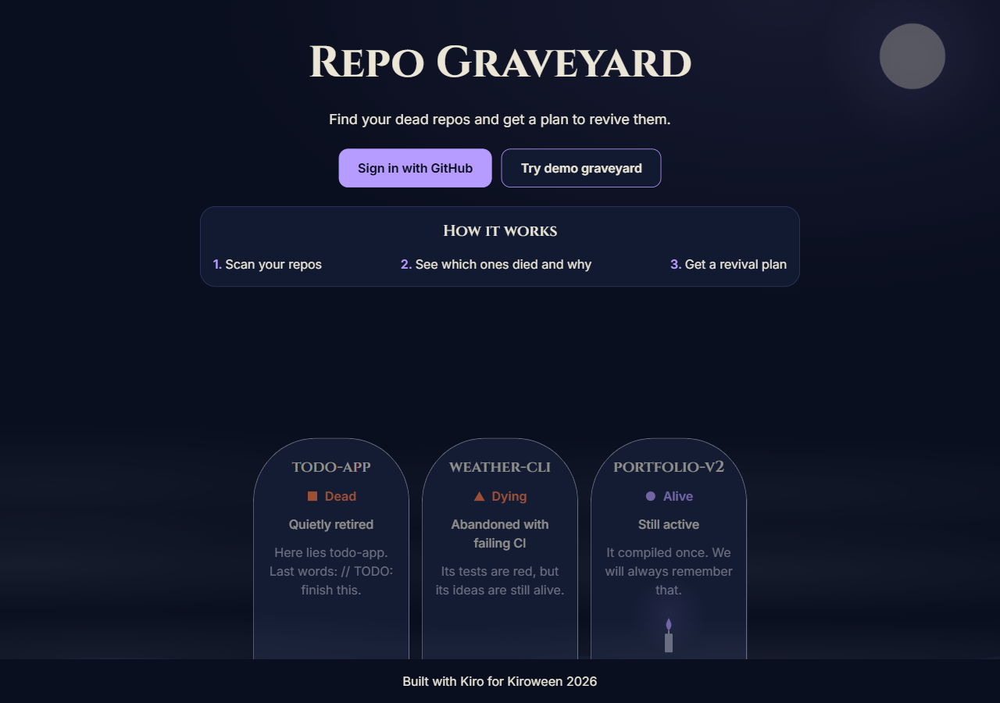
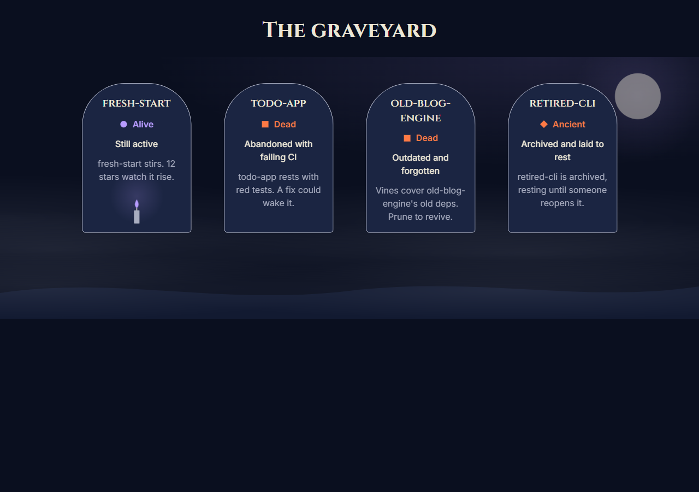
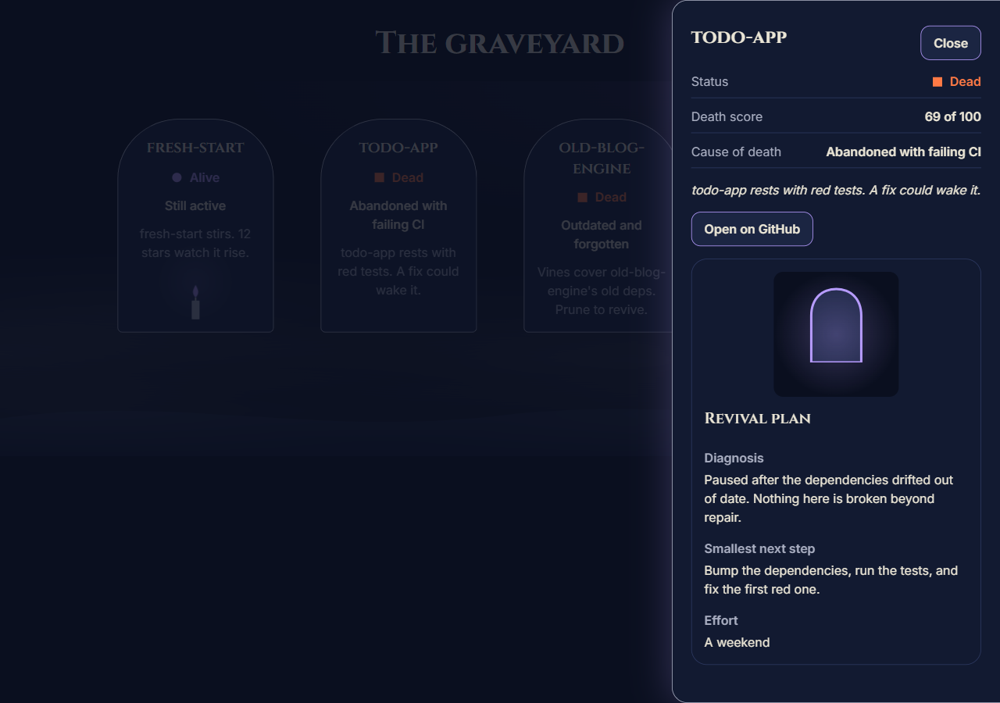

# Repo Graveyard

Find your dead repos and get a plan to revive them.

**Live demo:** [https://repo-graveyard-seven.vercel.app](https://repo-graveyard-seven.vercel.app)

Repo Graveyard is a haunted web dashboard for unfinished GitHub projects. It reads your repositories, scores how abandoned each one is with fixed rules, and shows each repo as a tombstone in a graveyard scene. Open a tombstone to see its death score and cause of death, then click Resurrect. A revival plan and a ready-to-file GitHub issue are written by an AI, or by fixed rules when the AI is unavailable, and you can file that issue on the repo with one click. It is built for students, freelancers and hobbyists with many half-finished repos. The tone is dark humor that jokes about a repo's fate, never about you. A repo is paused, not failed.

## Screenshots

**Landing page**



**The graveyard**



**Detail drawer with a revival plan**



## Features

- **Sign in with GitHub.** Auth.js with the `public_repo` scope. The GitHub token stays in the encrypted session cookie and never reaches the browser.
- **Scan.** `POST /api/scan` reads up to 300 repos on the server, skips forks, checks every GitHub response with Zod and returns typed, safe errors. Results are cached in memory for one hour per user and five minutes for the demo account.
- **Death score.** A pure function turns a repo's facts into a 0 to 100 score, a status (`alive`, `dying`, `dead` or `ancient`), a cause of death and an epitaph. The same input always gives the same result, and AI is never used for scoring.
- **Graveyard scene.** One tombstone per repo. The status has a text label and its own shape, the cause and epitaph are shown on the stone, and a lit candle means recent activity. The moon and sky get brighter the more repos are alive, and three fog layers drift behind the stones.
- **Detail drawer.** A modal dialog with the repo's status, death score, cause of death, epitaph and a link to the repo on GitHub. Focus is trapped inside, and Escape, the Close button or a click outside closes it.
- **Resurrect.** `POST /api/resurrect` gathers a small, length-capped bundle of repo context and asks Gemini for a revival plan with a diagnosis, a smallest next step and an effort estimate. If the model output is invalid, the server returns a rule-built plan instead. The result is rate limited per session.
- **File this issue.** `POST /api/issue` files the plan as a GitHub issue on the signed-in owner's repo. It refuses archived repos, repos with issues turned off and any repo that is not yours.
- **Demo mode.** Explore the graveyard and generate revival plans with no login. Filing issues is disabled.
- **Accessibility.** Keyboard navigation, a skip link, visible focus rings, and `prefers-reduced-motion` turns off the animation loops.
- **Security headers.** Every response sets `X-Content-Type-Options`, `Referrer-Policy`, `X-Frame-Options` and `Permissions-Policy`.

## How it works

1. **Sign in or try the demo.** Sign in with GitHub, or open the demo graveyard with no account.
2. **Scan.** The server reads your repositories from GitHub and validates every response against a Zod schema.
3. **Score.** Fixed rules turn each repo's facts into a death score, a status, a cause of death and an epitaph.
4. **Visit the graveyard.** Each repo is a tombstone. Click one to open its drawer.
5. **Resurrect.** The server asks an LLM for a revival plan from a capped bundle of repo context and validates the answer. You can then file the plan as a GitHub issue.

AI writes, rules judge. The LLM only writes the revival plan and the issue text.

## Tech stack

- [Next.js](https://nextjs.org) 16 (App Router) and React 19, with strict TypeScript
- [Tailwind CSS](https://tailwindcss.com) 4 and plain CSS using design tokens
- [Framer Motion](https://www.framer.com/motion/) for animation
- [Auth.js](https://authjs.dev) (`next-auth` v4) with the GitHub provider
- [Octokit](https://github.com/octokit/octokit.js) for GitHub API calls, server-side only
- [Zod](https://zod.dev) for runtime validation
- [Google Gen AI SDK](https://www.npmjs.com/package/@google/genai) behind a provider-agnostic adapter, server-side only
- [Vitest](https://vitest.dev) and [fast-check](https://fast-check.dev) for unit and property tests
- [Playwright](https://playwright.dev) for end-to-end tests

There is no database. State lives in server memory and in the Auth.js session cookie.

## Setup

You need a recent Node.js (Next.js 16 needs 20.9 or newer) and a GitHub account.

### 1. Clone and install

```bash
git clone https://github.com/tahir3693/Repo-Graveyard.git
cd Repo-Graveyard
npm install
```

### 2. Create a GitHub OAuth App

1. Open GitHub, then **Settings**, **Developer settings**, **OAuth Apps**, **New OAuth App**.
2. Set **Homepage URL** to `http://localhost:3000`.
3. Set **Authorization callback URL** to `http://localhost:3000/api/auth/callback/github`.
4. Register the app, copy the **Client ID** and generate a **Client secret**.

### 3. Copy `.env.example` to `.env.local` and fill it in

```bash
cp .env.example .env.local
```

On Windows PowerShell, use `Copy-Item .env.example .env.local`.

| Variable | Required | What to put there and where to get it |
|---|---|---|
| `GITHUB_ID` | Yes | The OAuth App's Client ID, from step 2. |
| `GITHUB_SECRET` | Yes | The OAuth App's Client secret, from step 2. |
| `AUTH_SECRET` | Yes | A random string that signs session cookies. Generate one with `openssl rand -base64 32`. |
| `NEXTAUTH_URL` | Yes | The app's base URL, `http://localhost:3000` for local runs. |
| `LLM_API_KEY` | For Resurrect | A Gemini API key from [Google AI Studio](https://aistudio.google.com/apikey). Used only on the server. |
| `LLM_MODEL` | No | A Gemini model id. Defaults to `gemini-3.5-flash-lite` when empty. |
| `GITHUB_DEMO_USERNAME` | For demo mode | The public GitHub username whose repos demo mode shows. |
| `GITHUB_DEMO_TOKEN` | No | A read-only GitHub personal access token that raises rate limits for demo mode. Create one under **Settings**, **Developer settings**, **Personal access tokens**. |
| `GITHUB_API_BASE_URL` | No | Test-only. Points GitHub calls at a local mock on a loopback address. Leave it empty. |

`.env.local` is ignored by git. Never commit it, and never put a real value in `.env.example`.

### 4. Run

```bash
npm run dev
```

Open [http://localhost:3000](http://localhost:3000).

## Demo mode

Demo mode lets anyone explore the graveyard with no login.

1. Set `GITHUB_DEMO_USERNAME` in `.env.local` (and optionally `GITHUB_DEMO_TOKEN`).
2. Open the landing page and click **Try demo graveyard**. You go to `/graveyard?demo=1`.
3. Click a tombstone to open its drawer, then click **Resurrect** to see a revival plan.

Demo mode scans the one public account you configured, never reads a user session, and caches results for five minutes. **File this issue** is disabled in demo mode. The server answers any issue request from a demo session with `403 demo_mode` and makes no GitHub call.

## Tests

| Command | What it runs |
|---|---|
| `npm run lint` | ESLint, including rules that keep server-only code and secrets out of client files. |
| `npm run typecheck` | `tsc --noEmit`. |
| `npm run test` | Vitest unit tests and fast-check property tests, which live next to the code as `*.test.ts`. |
| `npm run e2e` | Playwright end-to-end tests in `e2e/`. They build the app, start it on port 3100 with a mock GitHub server, and run in your installed Google Chrome. |
| `npm run check:bundle` | After `npm run build`, checks the client bundle for secrets and server-only code. |

## Built with Kiro

This project was built with [Kiro](https://kiro.dev): steering files, specs, hooks, MCP servers and a custom agent. See [docs/how-kiro-was-used.md](docs/how-kiro-was-used.md) for what each one did and which parts were verified.

## License

[MIT](LICENSE)
